# Shape Legend player guide

Describes main at 1c528280eeb531681d8e54bce0c814031a72a6ec (version tester-1+1c52828), written 2026-11-12.

## Changed in this version

This edition updates the tester-1+96dcc2a edition. Entries marked "(changed in tester-1+1c52828)" or "(new in tester-1+1c52828)" are what moved.

- **Guardian health bar.** Every guardian shows a blue Shield strip over a red Health strip. It cracks when the Shield strip empties (section 13).
- **Fury.** Warden, Spindle, Ember, Mirage and Gravitas break for 4.5 s when their Shield strip empties, then fight enraged until they fall. Brood's Broodlings go into a frenzy instead (section 13).
- **Guardian retune.** New hit points for every guardian, Brood splits into Broodlings with their own bar, Spindle needles, Ember Leavers, a wider Mirage opening, Gravitas tide and shelter pools (section 13).
- **Calmer guardian fights.** Fewer regular enemies while a guardian is on the field, set by difficulty: none on Easy (sections 6 and 13).
- **Bigger guardian arenas** from level 10, and par per difficulty on guardian levels (sections 4, 12 and 13).
- **Hit feedback.** A white flash, sparks and a soft tick when your shot lands on a guardian. The old heavy guardian hit sound is gone (sections 13 and 17).
- **Pierce.** 1.5 times damage on guardians; passes through a Bulwark's shield and takes 2 hit points off a Bulwark (sections 8 and 10).
- **Trough levels.** A valley arena from level 24 that pulls your ship toward its floor, and a Free Play "Arena surface" row (sections 7, 12 and 14).
- **Endless and Free Play guardians** open with Brood, then Warden. The Free Play Bosses row reads "Every 2 min" (sections 13 and 14).
- **Start card.** A mission type headline, a Return to Menu button, and no clock on destroy and guardian levels (section 5).
- **Reset progress** also clears the story and your call sign (section 16).
- **Story.** The guardians from level 35 on serve Vecta (section 1).
- **For testers.** Developer items show only in tester sessions (section 18).

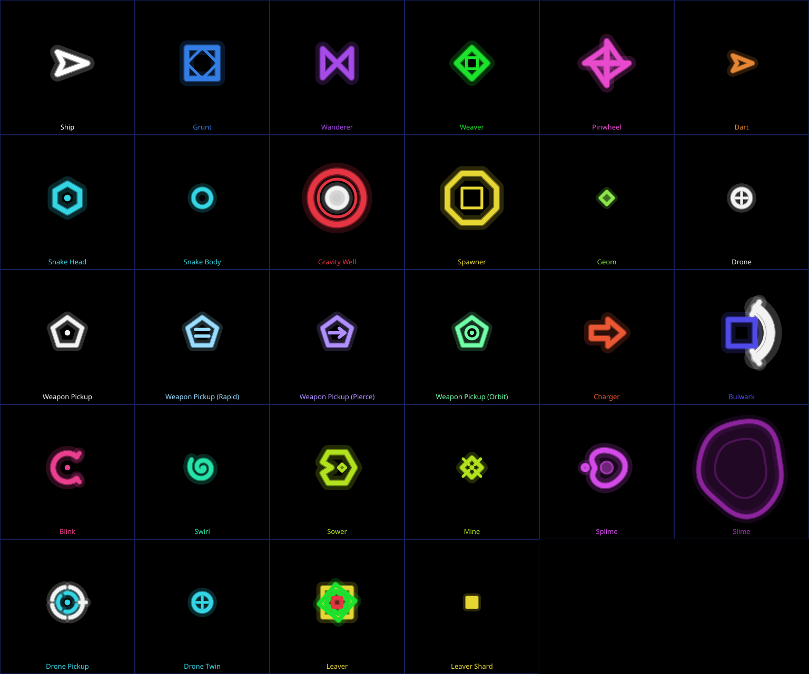

Distances are in arena units (u). The arena is always shown whole, so 1 u is a fixed share of the screen for a given arena. Your ship's hitbox has a radius of 10 u. Enemy speeds and hit points in this guide are for Normal difficulty; section 6 lists how the other difficulties change them.

## 1. The legend

Shape Legend has a story. It plays in Adventure only, as short scenes between levels. Endless and Free Play have no scenes.

### The premise

You are a pilot who wakes in Vertane, a galaxy made of shapes and lines of light. A plague called the Dim is draining its colour. Vertane called you to save it.

| Name | Who or what |
|---|---|
| Vertane | The galaxy. Its grid of light is the arena you fly in. |
| The Dim | The ancient plague. It turns shapes grey and hostile. Every enemy you fight is a Dim shape. |
| Geoms | The captured citizens of Vertane. Breaking a Dim shape frees them as the small green diamonds you collect. |
| Torus | The old guide, a being of nested shapes. Torus speaks to you in scenes. |
| Vecta | The Grey Legend, a legend who came before you. The story reveals what he did as you free the guardians. |
| Guardians | The ten bosses. The Dim took their colour. Beating one frees it. The guardians of levels 35 to 50 are servants Vecta corrupted (changed in tester-1+1c52828) |
| You | The pilot. You pick a call sign at the start. The pilot never speaks. |

### How scenes work

- **The opening** plays once, before level 1.
- **Call sign.** During the opening a picker asks for your call sign. It suggests a name made of two words (for example NovaFox). Tap "New name" for another, or type your own in the "Or type one" box: letters and digits only, 3 to 10 characters. Tap "Done". An empty box takes the suggestion. If you skip the opening, the suggestion becomes your call sign. The call sign is kept on your phone only. In scene text it replaces the token {callsign}.
- **Briefings.** Before the first level where a new enemy kind is in play, a short briefing names it and gives one tip. At most two briefings play before one level; the rest wait for the next level. A combo briefing plays when two kinds that work together first share a level.
- **Guardian intro.** Before each boss level a scene introduces the guardian and says what to watch for.
- **Freeing.** After you beat a guardian, a short scene shows it freed, before the results.
- **Order at a level start:** the opening (once), then up to two briefings, then one combo briefing, then the guardian intro.
- **Reading.** Text types out at 40 characters a second. Tap to finish the line, tap again for the next panel. "Tap to continue" shows when a panel is done.
- **Skip.** The large Skip button at top right ends the scene in one tap. The next queued scene still opens. A skipped scene counts as seen.
- **Once per save.** Each scene plays once. While a scene is open the game is held, and folding the phone does not pause it.
- **Replay.** On Level select, tap "Replay story", then tap a level to see again the scenes you first saw on it. Tap "Play levels" to go back to normal level select.
- Every difficulty shows the same scenes.

### The opening

Copied word for word from the game. {callsign} is your call sign. Lines marked Torus are spoken by Torus.

1. "You wake in the dark. No sky. No ground." / "Only lines of light, and one small ship."
2. "The ship is yours. It waits for a name." / "What will the Vertane galaxy call you?" (the call sign picker opens here)
3. "{callsign}, the Shape Legend." / "The grid prayers have been answered."
4. "Welcome to Vertane, a once peaceful" / "and brilliant galaxy."
5. "Until the Dim arrived, an ancient plague" / "spreading to extinguish our brightness."
6. "Vertane called you here... to save us." / Torus: "Good, you can hear the Voice of Vertane."
7. Torus: "Let's prepare you for battle."

### Combo briefings

Each enemy's own briefing is in its entry in section 10. Each guardian's intro and freeing are in section 13. Two combo briefings play up to level 30:

- **Charger with Splime.** "Slime slows you, and Chargers dash fast." / "Slow feet cannot step off a dash line." Then: "Keep to clean floor when Chargers come," / "so you can always step aside."
- **Gravity well with Snake.** "Wells pull you, and Snakes are long." / "A pull can drag you into a tail." Then: "Break the well first, then the Snake." / "Then the floor is yours again."

This guide quotes the story only up to level 30.

## 2. Quick start

- **Goal.** Each Adventure level has one goal: score a target before the clock runs out, survive a time, or destroy a number of enemies. Every 5th level is a guardian level: survive until the guardian arrives, then defeat it.
- **Left thumb moves.** Put your thumb down anywhere on the left half of the screen. That spot becomes the stick centre. Slide to fly.
- **Right thumb aims and fires.** Put your thumb down anywhere on the right half. Slide in a direction and the ship fires that way, nonstop, while you hold.
- **Bomb.** Tap the BOMB button on the right edge. It wipes every enemy off the arena, with no points. You get 3 per level.
- **Collect geoms.** Broken enemies drop small lime green diamonds called geoms. Fly near them and they fly to you. Each geom adds 1 to your multiplier and 1 to your super charge.
- **Do not touch anything.** An enemy, a gravity well, an armed mine or a guardian's attack costs a life. On Normal you have 3 lives per level.
- **Super.** The super button sits just above the bomb. It fills as you collect geoms (60 to fill). When it reads READY, tap it.
- **Difficulty.** Pick Easy, Normal, Hard or Insane on the start card, then tap Start.

## 3. Controls

The controls are the same on every screen. Only the button positions move. The game picks the layout from the screen shape: if the width is at least 1.8 times the height it uses the wide layout (the Fold's cover screen), otherwise the main layout (the Fold's inner screen and most phones).

### Wide screen (cover, 21:9)

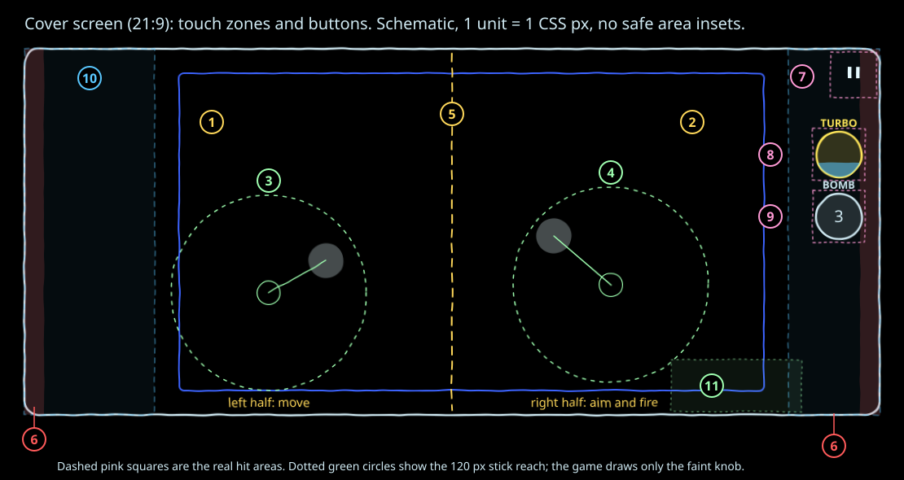

| # | Zone or button | What it does |
|---|---|---|
| 1 | Left half of the screen | The first finger down here becomes the move stick. |
| 2 | Right half of the screen | The first finger down here becomes the aim stick. Holding it past the dead zone fires. |
| 3 | Move stick | Appears where your thumb lands. Only a faint knob is drawn under your thumb. |
| 4 | Aim stick | Same as the move stick. The ship turns to face the aim direction. |
| 5 | Centre line | Splits move from aim. The split is the middle of the whole screen, HUD columns included. |
| 6 | Edge strips, 24 px each side | A touch that starts here is ignored, so the phone's back swipe does not grab a stick. Buttons still work there. |
| 7 | Pause (top right) | Opens the pause screen. Hit area 56 px square. |
| 8 | Super button | Right edge, on top. Hit area 64 px square. Labelled with the super's name, or READY when full. |
| 9 | Bomb button | Right under the super, 12 px below it. Hit area 64 px square. Labelled BOMB, with the bombs left inside it. |
| 10 | HUD columns | Display only (left column 160 px, right column 112 px). Touches here still start sticks. |
| 11 | Thumb rest area | Where the right thumb usually rests. Not a touch zone. The button stack is placed as low as it can sit while staying clear of an aim stick started here. |

### Main screen (10:9 and most phones)

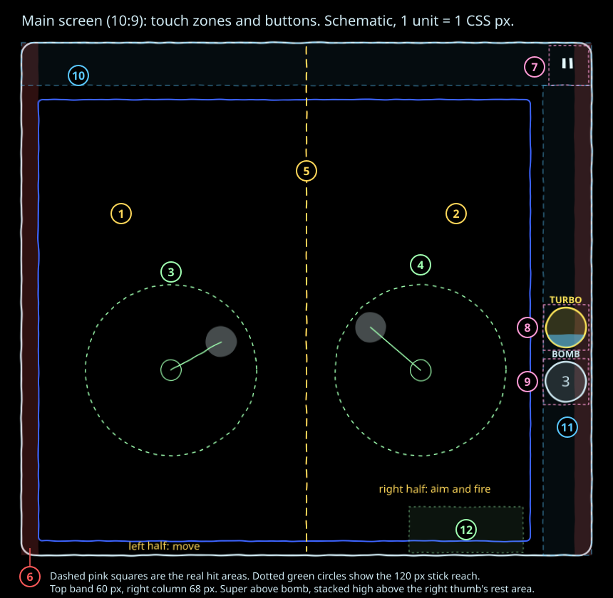

| # | Zone or button | What it does |
|---|---|---|
| 1 | Left half | Move stick starts here. |
| 2 | Right half | Aim stick starts here. |
| 3 | Move stick | Floating, faint knob only. |
| 4 | Aim stick | Floating, fires past the dead zone. |
| 5 | Centre line | Middle of the whole screen. |
| 6 | Edge strips, 24 px | Stick starts here are ignored. |
| 7 | Pause (top right) | Opens the pause screen. Hit area 56 px. |
| 8 | Super button | Right column, on top. Hit area 64 px. |
| 9 | Bomb button | Under the super. Hit area 64 px. |
| 10 | Top band, 60 px | Score, clock and status. Display only. |
| 11 | Right column, 68 px | Holds the buttons. Display only apart from the buttons. |
| 12 | Thumb rest area | Not a touch zone. The buttons sit above it. |

There is no bottom band layout any more. The game always uses one of the two layouts above.

### Stick behaviour

| Property | Value |
|---|---|
| Origin | Wherever your thumb first touches. Not a fixed spot. |
| Reach | 120 CSS px from the origin. |
| Follow | Slide past the reach and the stick centre is dragged along, so your thumb stays on the edge of the ring. |
| Dead zone | 12 percent of the reach (14.4 px), on both sticks. Inside it the stick reads zero: no movement, no fire. |
| Response | Linear. Past the dead zone the output rises evenly to full at the reach. |
| Move speed | Full deflection is 420 u/s with space physics off. See section 7. |
| Aim | Past the dead zone the aim angle is the stick angle and the ship fires. With no aim, the ship faces where it moves. |
| Visual | A small faint knob (21.6 px radius, 30 percent alpha) under each thumb. No ring. It vanishes when you lift. |
| Extra fingers | One finger per stick. A second finger in the same half is ignored. |

### Buttons

- Buttons are checked before sticks, so a thumb that lands on a button never becomes a stick.
- A button reacts only to a new touch that starts on it. Sliding a stick over a button does nothing.
- A press counts once. Lift and tap again for another press.
- Bomb: fires if you have a bomb, you are alive, and 1.0 s has passed since the last bomb.
- Super: fires only when it is full and you are alive. Detonate also needs your drone to be there.
- Button look: a charging super fills cyan from the bottom. A full super pulses once a second and reads READY. An empty bomb button goes dim.

### Pause, fold and back

- The pause button, switching away from the app and folding or unfolding the phone all pause the game.
- On a fold the HUD and buttons move to the new layout. A stick whose start point is now off screen is dropped. Tap Resume when ready.
- In a browser, the first back gesture pauses the game instead of leaving the page.
- A fold can drop fullscreen. Your next tap asks for fullscreen again.
- The game asks for landscape. If the phone refuses, it still plays in portrait.
- The pause screen ("Paused") has Resume, Restart, Settings and Quit.

## 4. Core loop and scoring

**Break an enemy, it drops geoms, geoms raise the multiplier, so later kills score more.**

### HUD on the wide screen

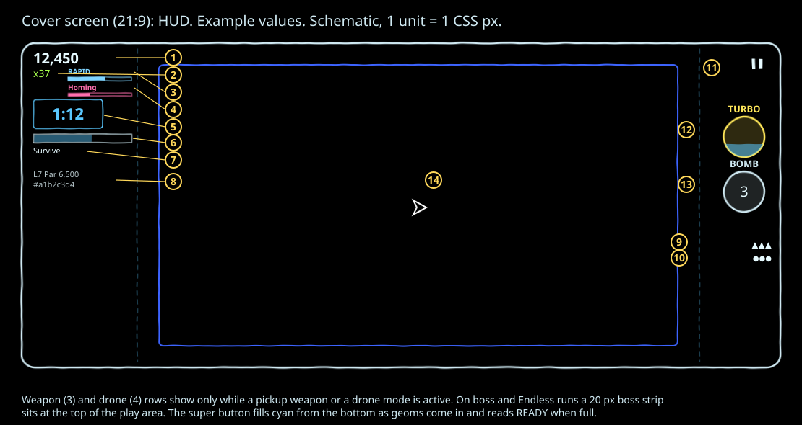

| # | Item | Meaning |
|---|---|---|
| 1 | Score | Points this level, with thousands separators. |
| 2 | Multiplier | Lime green "x" number. Starts at x1. |
| 3 | Weapon | Pickup weapon or combo name and a bar that drains over 20 s. Hidden while you have spread. |
| 4 | Drone mode | Shown while a drone pickup is active (Homing, Detach, Rapid or Double), with its own bar. |
| 5 | Clock | Time left on timed goals. Destroy and guardian levels show no clock. See section 5. (changed in tester-1+1c52828) |
| 6 | Goal bar | Fills toward the goal. |
| 7 | Goal label | For example "Survive", "Destroy 23 / 60", "Score 3,200 / 5,000", "BOSS IN 1:05", then "Defeat the boss" once the guardian is on the field. (changed in tester-1+1c52828) |
| 8 | Level line | Level number and par, for example "L7  Par 6,500". The level code shows here only in tester sessions (section 18). (changed in tester-1+1c52828) |
| 9 | Lives | Under the buttons. One ▲ per life, up to 5, then "▲ x N". |
| 10 | Bombs | One ● per bomb, up to 5, then "● x N". |
| 11 | Pause | Two bars. |
| 12 | Super button | Name above it, cyan fill rising as you collect geoms. |
| 13 | Bomb button | BOMB above it, bombs left inside. |
| 14 | Arena | Always fully visible between the HUD columns. On guardian and Endless runs a 20 px boss strip sits at the top, with the guardian's name and its health bar: a blue Shield strip over a red Health strip (section 13). (changed in tester-1+1c52828) |

### HUD on the main screen

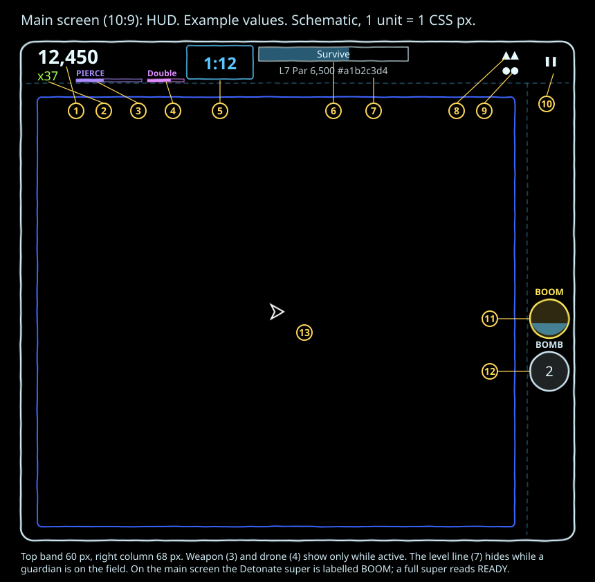

| # | Item | Meaning |
|---|---|---|
| 1 | Score | Top left. |
| 2 | Multiplier | Under the score. |
| 3 | Weapon | Right of the multiplier, with its bar. |
| 4 | Drone mode | Right of the weapon, while a drone pickup is active. |
| 5 | Clock | Its own box in the top band, on timed goals only. (changed in tester-1+1c52828) |
| 6 | Goal bar and label | Top centre. |
| 7 | Level line | Under the goal. Hidden while a guardian is on the field. |
| 8 | Lives | Top right, left of pause. |
| 9 | Bombs | Under lives. |
| 10 | Pause | Top right corner. |
| 11 | Super button | Right column. On this screen the Detonate super is labelled BOOM. |
| 12 | Bomb button | Under the super. |
| 13 | Arena | Below the top band, left of the column. |

### Where points come from

Points for a kill are the enemy's base value times your multiplier at that moment.

| Source | Base value | Geoms dropped |
|---|---|---|
| Wanderer | 10 | 1 |
| Pinwheel | 25 | 1 |
| Leaver shard | 25 | 0 |
| Dart | 30 | 1 |
| Grunt | 50 | 1 |
| Swirl | 80 | 1 |
| Weaver | 100 | 2 |
| Leaver | 100 | 2 |
| Charger | 120 | 2 |
| Blink | 130 | 2 |
| Splime | 140 | 2 |
| Bulwark | 150 | 3 |
| Spawner | 150 | 3 |
| Sower | 180 | 3 |
| Snake head | 200 | 4 |
| Gravity well, shot down | 250 | 5 |
| Snake body, Mine, Slime | 0 | 0 |
| Guardian | A fixed bonus, see section 13 | 20 |

These kills score: your bullets, orbit spikes, drone shots, the Ram drone, and the Detonate super. These remove enemies with no points and no geoms: bombs, your death, a gravity well eating an enemy, and a gravity well exploding.

### The multiplier and geoms

- The multiplier starts at x1 each level.
- Plus 1 per geom collected. Cap x999.
- It goes back to x1 only when you die.
- Geoms burst out from a kill, last 4 s, fly to you from 90 u away at 600 u/s and are collected within 28 u.
- At most 280 geoms lie on the field; the oldest go first.
- When you die every geom on the field vanishes.

### Worked examples

| Moment | Multiplier | Kill | Points |
|---|---|---|---|
| Level start | x1 | Grunt | 50 x 1 = 50 |
| After 20 geoms | x21 | Weaver | 100 x 21 = 2,100 |
| After 49 more geoms | x70 | Snake head | 200 x 70 = 14,000, then its 4 geoms take you to x74 |
| Later, at x100 | x100 | Gravity well shot down | 250 x 100 = 25,000, then its 5 geoms take you to x105 |
| At the cap | x999 | Sower | 180 x 999 = 179,820 |
| Just after a death | x1 | Grunt | 50 again |

Collecting geoms early matters more than killing fast. One death wipes the multiplier you built.

### Par and stars

- Each Adventure level has a par score: the score a strong player reaches. It is at least 1,000 and a multiple of 500 on Normal.
- Star targets: 1 star at par, 2 stars at 1.25 x par, 3 stars at 1.5 x par (each rounded to 500).
- Par and the star targets change with difficulty: x0.8 on Easy, x1 on Normal, x1.15 on Hard, x1.3 on Insane.
- Guardian levels have their own par for each difficulty instead, worked out from the score that difficulty really offers over the whole fight. The star targets are 1, 1.25 and 1.5 times that par as usual. (new in tester-1+1c52828)
- Stars from score are capped by difficulty: Easy at most 1 star, Normal at most 2, Hard and Insane at most 3.
- Stars are given only when you complete the goal. A failed level gives 0 stars.
- The start card shows the three star targets and the cap for the chosen difficulty, for example "Normal: up to 2 stars".
- Your best score and best stars per level are kept separately: a later run can raise either.

### The fourth star

Complete a level on Insane and you get 4 stars, whatever your score. The start card says "Insane: up to 3 stars, plus a 4th for a win". The fourth star is drawn as an iridescent star that shifts colour and spins once every 6 s, on the results screen and in Level select.

### Par rewards

Win an Adventure level with a score at or above par (par for your difficulty) and the results screen says "Par reached" and "Choose a reward for the next level". Pick one:

| Reward | Choices | Effect on the next level |
|---|---|---|
| Extra life | Life | Start with 1 more life |
| Extra bomb | Bomb | Start with 1 more bomb |
| Start with a weapon | Spread, Rapid, Pierce or Orbit | Start holding that weapon for its normal 20 s |

After you pick, the screen confirms it, for example "Extra life ready for level 7". The reward is for the next level only. A typed seed run saves no reward.

## 5. Levels and missions

### Adventure

- A sequence of generated levels. On the menu the button reads "Adventure", or "Continue  L<n>" once you have unlocked more than level 1.
- Each level comes from your run seed plus the level number. Your run seed is made once on first launch and kept. Retry replays the identical level.
- Completing the goal unlocks the next level, whatever your stars.
- Level select shows unlocked levels in pages of 12, newest page first, each with its best stars. It has Prev, Next, "Replay story" and Back.
- Each level: 3 lives (changed by difficulty), 3 bombs, one drone and one super, fixed by the level.

### The start card

Before each Adventure level a card holds the game until you tap Start. Top to bottom: (changed in tester-1+1c52828)

- **Title**: "Level N".
- **Mission type**: a headline in the pixel font, in the mission's colour (see the table below). (new in tester-1+1c52828)
- **Goal**: one line (see the table below). (changed in tester-1+1c52828)
- **Star targets**: "1 star", "2 stars", "3 stars" with their scores. (changed in tester-1+1c52828)
- **New enemies**: "New:" and an icon for each kind new to your run. (changed in tester-1+1c52828)
- **Difficulty chips**: Easy, Normal, Hard, Insane. Your last choice is picked. Tapping a chip rebuilds the level at that difficulty.
- **Start** and **Return to Menu**. Return to Menu goes back to the main menu without starting the level. (changed in tester-1+1c52828)
- **Details**, closed by default: the victory line, the star cap for the difficulty (for example "Normal: up to 2 stars"), the name and type of each new enemy, the drone, the super with what it does, a held par reward, the arena (for example "Circle 900 x 900"), on a trough level the line "The ground slopes. Your ship slides toward the valley.", and the seed. (changed in tester-1+1c52828)

### Mission types

| Mission | Headline on the card | Goal line on the card | Victory line | Win | Lose |
|---|---|---|---|---|---|
| Score | RUSH & SCORE, yellow (new in tester-1+1c52828) | "Score X in m:ss" | "X points when the m:ss clock runs out with a life left" | Your score is at or above the target when the clock runs out. The level always runs its full time, so you can keep climbing | Below target at time out, or out of lives |
| Survive | HOLD OUT, cyan (new in tester-1+1c52828) | "Survive m:ss" | "m:ss survived with a life left" | The clock counts down to 0 with a life left | Out of lives |
| Destroy | SEEK & DESTROY, red (new in tester-1+1c52828) | "Destroy N enemies before your lives run out" | "N kills with a life left" | Kill the number shown. The level ends the moment you reach it | Out of lives |
| Guardian | GUARDIAN, magenta (new in tester-1+1c52828) | "Survive until <name> arrives, then defeat it (1:25)" | "<name> destroyed, with a life left" | The guardian is destroyed | Out of lives. There is no time out |

- Scores on the card use a short form above 9,999, for example "12.3K".
- The score target is 60 percent of par, on the 500 grid, at least 1,000 and never above par, then scaled by difficulty like par.
- Destroy counts every scoring kill of a real enemy: each Dart, Snake head and Leaver counts 1. Snake segments, wells, Mines, Slime and Leaver shards do not count. Bomb and death clears do not count. A guardian counts 1.
- Levels 1 to 5 draw survive or destroy more often (score 20, survive 40, destroy 40 percent); later levels about a third each. From level 3, if the last three non guardian levels had no score mission, the next one is a score mission.

### Level length and pacing

| Level | Clock |
|---|---|
| 1 | 1:30 |
| 2 | 1:45 |
| 3 | 2:00 |
| 4 | 2:15 |
| 5 and up (not guardian) | One of 2:00, 2:15, 2:30, 2:45 or 3:00, drawn per level, never the same as the level before |
| Guardian levels | The guardian arrives at 1:25; the fight runs until it falls |

- On a destroy level the clock length is the time the enemy count is planned around.
- The first wave arrives 2.5 s in. Each level opens calm, then builds to its end.
- **A beat every minute.** At each full minute a formation (an extra group of one kind in a new pattern, at least 4 enemies) or a 10 s surge arrives. The first is either, then they take turns.
- **Final rush.** The last 20 s of a non guardian level bring more enemies.
- The wave schedule loops its harder half, so destroy levels never run out of enemies.
- Levels 1 to 14 are gentler: fewer enemies per wave, rising to the full amount by level 15.

### The clock

| Goal | Clock shows |
|---|---|
| Survive, Score | Time left, counting down |
| Destroy, Guardian | No clock (changed in tester-1+1c52828) |

On a countdown the clock changes as time runs out:

| Time left | Colour |
|---|---|
| Over 1:00 | Cyan |
| 1:00 or less | Yellow |
| 0:30 or less | Orange |
| 0:10 or less | Red and large |

Time warnings: at 1:00 a soft chime, at 0:30 a second soft chime, and from 0:10 the clock pulses once a second. From 0:05 a low tick sounds each second, rising in pitch, a little louder at 3, 2 and 1. A level that starts under a mark skips that warning.

The clock runs on the wave clock, which stops while you are dead.

### Results screen

| Item | Shows |
|---|---|
| Headline | "Victory" or "Defeated" |
| Level line | "Level N  <arena> arena" and a difficulty chip |
| Score block | Score, par, a bar with 1★ 2★ 3★ marks, stars earned and the cap line |
| Best | Your best score and stars, with "New best" when beaten |
| Par reward | The reward choice, when earned |
| Buttons | Next (after a win) or Retry, and Menu |
| Details | Time, kills, geoms, best multiplier, guardian bonus, space physics, seed, level code, build |

## 6. Difficulty

Pick a difficulty on each Adventure and Endless start card. Free Play picks it on its own setup screen. The last choice is remembered. The default is Normal.

| Effect | Easy | Normal | Hard | Insane |
|---|---|---|---|---|
| Lives per level | 5 | 3 | 2 | 2 |
| Enemy speed | x0.8 | x1 | x1.15 | x1.38 |
| Enemy hit points | x0.75 | x1 | x1.3 | x1.56 |
| Enemies per wave | x0.87 | x1 | x1.15 | x1.32 |
| Most enemies alive at once | x0.9 | x1 | x1.15 | x1.6 |
| Guardian hit points and attack speed | x0.55 | x1 | x1.35 | x1.62 |
| Guardian minions | x0.75 | x1 | x1.25 | x1.6 |
| Regular enemies after a guardian enters | None | 25 percent of the usual waves | 50 percent | 60 percent (new in tester-1+1c52828) |
| Guardian warning time | x1 | x1 | x1 | x0.85 |
| Drift, trough pull and pond ripple push | x0.7 | x1 | x1.3 | x1.6 (changed in tester-1+1c52828) |
| Par and star targets | x0.8 | x1 | x1.15 | x1.3 (guardian levels have their own par per difficulty, section 4) (changed in tester-1+1c52828) |
| Most stars | 1 | 2 | 3 | 3, or 4 for any win |
| Space physics | Off | Low | Medium | High |

- Bombs stay at 3 on every difficulty.
- Hit points are rounded, never below 1, so a 1 hit enemy stays 1 hit.
- Space physics now follows difficulty (section 7).
- No difficulty is locked.

## 7. Your ship

| Property | Value |
|---|---|
| Shape | White arrowhead. The nose points where you aim, or where you move when not aiming |
| Hitbox | Radius 10 u |
| Top speed | 420 u/s (space physics Off and Low), 460 (Medium), 520 (High) |
| Lives | 3 per Adventure level on Normal (section 6) |
| Respawn | 1.5 s after death, at the arena centre, standing still |
| Invulnerability | 2.0 s after spawning and after each respawn. The ship blinks 6 times a second while it lasts |
| Walls | You slide along walls and obstacles. No bounce, no damage |

When you die:
- Lives drop by 1 and the multiplier goes to x1.
- Every enemy, segment, Mine and Slime is removed with no score. Gravity wells, Spawners, a guardian and its parts, and any pickup on the floor stay.
- All geoms and enemy bullets vanish. Your weapon goes back to spread. Your drone disappears until you respawn and its drone mode ends.
- The phone vibrates once for 60 ms, where the phone supports it.
- The wave clock stops until you are back, so you do not miss spawns or lose goal time.
- Bombs are not refunded. Super charge is kept.

### Space physics

Space physics is set by difficulty: Easy Off, Normal Low, Hard Medium, Insane High. It is no longer a settings row.

- **Off.** Your speed follows the stick exactly and instantly.
- **Low, Medium, High.** The stick is a thruster. The longer you hold it, the harder you push, up to a ceiling. Let go and you drift, slowing under drag, and stop dead below 3 u/s. Pushing against your drift brakes harder. Walls still slide.

| Level | Start push (u/s²) | Push ceiling (u/s²) | Push growth time (s) | Top speed (u/s) | Drag when released (per s) | Brake boost |
|---|---|---|---|---|---|---|
| Off | instant | instant | none | 420 | none, stops at once | none |
| Low | 1200 | 2400 | 0.6 | 420 | 4 | x2.5 |
| Medium | 800 | 2000 | 0.8 | 460 | 2.5 | x2.0 |
| High | 500 | 1800 | 1.0 | 520 | 1.2 | x1.6 |

- Half deflection gives half push, but the top speed stays the same.
- Respawning zeroes your speed.
- Slime halves your top speed. Turbo raises it by 35 percent.
- Inside a Gravitas shelter pool (section 13) your ship handles as on High for as long as you stay in it, whatever the difficulty. (new in tester-1+1c52828)

### Trough pull

On a trough level (section 12) the ground pulls your ship, and only your ship, toward the valley floor down the middle. The pull is almost nothing on the floor and strongest at the left and right rims: about 240 u/s at the rim on Normal, changed by difficulty like drift (section 6). Your top speed is higher, so you can always climb to a rim, but you must keep pushing to stay there. Enemies, bullets, geoms and pickups are not pulled. (new in tester-1+1c52828)

## 8. Weapons

You start each level with spread. Kills drop weapon pickups that give you a weapon for 20 s. Two different weapons combine.

### The four weapons

| Image | Weapon | How it fires | Rate | Bullet |
|---|---|---|---|---|
| | Spread (default) | 3 bullets at minus 6, 0 and plus 6 degrees from your aim | 12 volleys a second | 1400 u/s, radius 4 u, life 1.2 s. Stops on the first hit |
|  | Rapid | 2 parallel bullets, 5 u either side of your aim line | 26 volleys a second | 1500 u/s, radius 3 u, life 1.0 s. Stops on the first hit |
|  | Pierce | 1 heavy bullet | 8 a second | 1600 u/s, radius 6 u, life 1.0 s. Hits up to 4 different enemies |
|  | Orbit | Spikes circle you. No forward bullets | none | See below |

- Your speed along the aim is added to bullet speed, up to 1600 u/s.
- Every bullet hit does 1 damage, except Pierce on a Bulwark (2 damage). (changed in tester-1+1c52828)
- Snake body segments stop a pierce bullet. A Bulwark's shield absorbs every bullet except Pierce and the combos with Pierce (Trident, Needle, Eclipse), which pass through it. A guardian's body stops every bullet, pierce included. (changed in tester-1+1c52828)
- Pierce does 1.5 times its usual damage to guardians and their parts (section 13). (new in tester-1+1c52828)
- Gravity wells bend your bullets, and a bullet that touches a well's core is used up on it. Bullets vanish on walls.

### Orbit and the chainsaw

- 8 spikes in two rings of 4: an inner ring at 80 u turning forward, an outer ring at 100 u turning back. They spin 2.4 times a second.
- A spike does 1 damage to the first enemy it touches, then rests 0.12 s. Spikes are never used up. They pass through Snake body segments and can hurt gravity wells. A Bulwark shield blocks them.
- **Chainsaw.** Hold the aim stick and the spikes facing your aim stretch out into a saw bar over 0.25 s. At full stretch the outer tip reaches 320 u and the inner 208 u. The bar is longest straight ahead and fades out 70 degrees to either side.
- Spikes on the bar hit every enemy along their sweep. Once the saw is more than half out, hits alternate 1 and 2 damage and spikes rest 30 percent less.
- Orbit makes no shot sound. The saw buzzes while it runs.

### Combos

Pick up a different weapon while you hold one and the two join into a combo for a fresh 20 s.

| Combo | Pair | Rate | How it fires |
|---|---|---|---|
| Hail | Spread and Rapid | 22 a second | A 3 way fan at 5 degrees of small fast bullets (1500 u/s, life 0.9 s) |
| Trident | Spread and Pierce | 10 a second | A 3 way fan at 8 degrees of pierce bullets (radius 5 u) that hit 2 enemies each |
| Halo | Spread and Orbit | 10 a second | The spread fan plus the orbit spikes |
| Needle | Rapid and Pierce | 14 a second | 2 parallel pierce bullets (radius 4 u) that hit 3 enemies each |
| Whirl | Rapid and Orbit | 18 a second | Rapid's twin bullets plus spikes spinning 3 times a second |
| Eclipse | Pierce and Orbit | 8 a second | A pierce bullet that hits 3 enemies, plus spikes spinning 2 times a second that each hit up to 3 enemies at rest |

### Pickups

| Rule | Value |
|---|---|
| Look | A spinning outline with a mark for its weapon (see the images above) |
| When | Counted on scoring kills. The first is due at kill 15, then every 25 (40, 65, 90 and so on). While you hold a pickup weapon the next one is due within 12 kills, so combos come quickly |
| Where | At the kill that made it due |
| How many | One on the floor at a time |
| Life | 8 s on the floor. It blinks in the last 2 s |
| Pick up | Fly within 28 u of it |
| Duration | 20 s. The HUD bar drains over that time |
| Same again | The same weapon, or either half of your combo, refills the 20 s |
| Different | With one weapon: forms the combo. With a combo: the older half is replaced by the new weapon |
| On death | You go back to spread. A pickup on the floor stays |
| Bombs | Leave pickups alone. The end of a level removes them |

Which weapons drop depends on the level: levels 1 to 5 drop rapid only, levels 6 to 15 rapid or pierce, level 16 and up and Endless all three. While you hold a pickup weapon, spread can also drop (to build Hail, Trident or Halo). The same weapon never drops twice in a row when there is a choice. The choice comes from the level seed, so a replay drops the same weapons in the same order.

HUD colours: RAPID light blue, PIERCE violet, ORBIT green. A combo takes the colour of its later half. The HUD shows combos in capitals: HAIL, TRIDENT, HALO, NEEDLE, WHIRL, ECLIPSE.

### Weapon sounds and cues

- **Combine.** A rising three note chime in the music's key. The weapon label flashes for 0.6 s and shows "combined" for 1.5 s.
- **Expiry.** A falling two note chime. The weapon label and bar disappear.
- **Single pickup.** A burst of sparks in the weapon's colour.

### Settings toggle

Settings, Weapon pickups: On (default) or Off. Off means no weapon pickups and no drone pickups drop, and the kill count stops. A weapon you already hold runs out normally.

## 9. Bombs, drones and supers

### Bombs

| Rule | Value |
|---|---|
| Stock | 3 per level (plus 1 from a par reward). Endless: 3 at start, plus 1 every 150,000 points, at most 9 |
| Cooldown | 1.0 s between bombs |
| Effect | Removes every enemy, every spawning enemy, every Snake segment, every Mine, every Spawner, every Slime puddle and every enemy bullet. Gravity wells are not destroyed: they shrink back to their starting size and health |
| Guardians | A bomb clears a guardian's attacks and minions and stuns it for 1.5 s. It does no damage and does not remove its pods, anchors or turrets |
| Score | None for anything removed, and no geoms. Geoms already on the floor stay |
| Not affected | Pickups. The Bulwark shield does not stop a bomb |

A bomb is a life saver, not a score tool. Use it the moment you are boxed in.

### Drones

One drone per level, named in the start card's Details. Drones cannot be hurt, are not pulled by wells and vanish while you are dead.

| Drone | Behaviour | Numbers |
|---|---|---|
| Attack | Circles you and shoots the nearest enemy or guardian | Circle radius 60 u at 1.5 turns a second. Range 450 u. 4 shots a second |
| Collect | Follows behind you and pulls in geoms | 50 u behind you. Pulls geoms within 260 u at 900 u/s |
| Ram | Circles you, then charges the nearest enemy | Range 400 u. Charge 700 u/s. 2 damage, then a return at 900 u/s and a 1.2 s rest |

Which drone you get: levels 1 to 5 always Attack. Levels 6 to 15: Attack 50, Collect 30, Ram 20 (weights). Level 16 and up: about a third each. Endless: always Attack. Free Play: your choice.

### Drone pickups

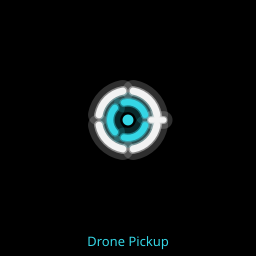

A spinning ring pickup arms your drone for 20 s in one of four modes. While armed, every drone type also shoots the nearest target within 450 u.

| Mode | Effect |
|---|---|
| Homing | The drone fires 4 shots a second that home on enemies |
| Detach | The drone flies 280 u ahead along your aim and holds that post as a decoy. Enemies near it chase it, and aimed guardian shots aim at it. It fires 4 a second |
| Rapid | The drone fires 10 shots a second |
| Double | A second drone joins on the far side of your orbit. Each fires 4 a second |

- Drops at scoring kill 30, then every 40 (70, 110 and so on). Life 8 s on the floor. Fly within 28 u to take it.
- The mode is picked from the level seed and never repeats the previous one.
- A new drone pickup replaces the mode and restarts the 20 s.
- The mode ends early if you die. The HUD shows the mode name and a bar while it lasts.
- Drone pickups drop only while Weapon pickups is On.

### Supers

One super type per level, named on the super button and in the start card's Details.

| Rule | Value |
|---|---|
| Charge | 1 per geom collected, full at 60 |
| Use | Tap the super button when it reads READY. Charge empties and refills from new geoms, so you can use it more than once |
| On death | Charge is kept. You cannot fire it while dead |

| Super | Effect | Numbers |
|---|---|---|
| Homing | Every bullet you fire turns toward the nearest target | 5 s. Seeks within 300 u. Turns up to 540 degrees a second. Bullets fired in the window keep homing until they expire. Spikes do not home |
| Detonate | Your drone explodes and destroys every enemy within 260 u of it, for full score and geoms | Snake heads die and their segments go with them. Gravity wells are not hurt. A guardian in range loses 10 percent of its full health. The drone is gone for 3 s. Needs the drone to be there |
| Turbo | Faster fire, a faster ship and bullets that pass through enemies | 10 s. Fire rate x2.5, top speed x1.35. Bullets pass through 2 enemies and stop on the third. Each scoring kill adds 0.25 s, up to 15 s in all. Turbo has its own music and engine hum |

Which super you get: levels 1 to 5 Homing 34 or Turbo 66 (weights). Level 6 and up: about a third each. Endless: always Turbo. Free Play: your choice.

## 10. Enemies

### Rules for every enemy

- **Telegraph.** Every wave enemy appears as a flashing outline for 0.6 s before it is live. During that time it cannot hurt you and cannot be hit. Darts from a Spawner telegraph for 0.4 s.
- **Contact kills.** Touching any live enemy costs a life unless you are invulnerable.
- **Walls.** Enemies slide along walls. Wanderers and Pinwheels bounce.
- **Crowding.** Enemies of the same kind push gently apart.
- **Speed by level.** x1.00 for levels 1 to 5, x1.05 for 6 to 15, x1.10 for 16 to 30, x1.20 at 31 rising 0.005 a level to x1.40. Small arenas slow enemies a little (down to x0.88).
- **Safe spawns.** A fixed spawn point within 180 u of you is moved to the mirrored point; if that is close too, the spawn waits 0.5 s.
- **Cap.** Each level has a most enemies alive at once: 60 in levels 1 to 5, 90 in 6 to 15, 120 in 16 to 30, 160 from 31, lower in levels 1 to 14, and changed by difficulty. Extra spawns wait.
- **Decoys.** Enemies within 640 u of a detached drone chase it instead of you.
- **Membranes** make enemies that cross them angry: see section 11.
- **No ordinary enemy shoots.** Only guardians fire bullets.

Bands: levels 1 to 5 are band 1, 6 to 15 band 2, 16 to 30 band 3, 31 and up band 4. Each level picks a roster of 3 to 6 kinds, Grunt always included. The weights below are the chance shares for that pick. The briefing lines are copied word for word from the game.

### Grunt

| Field | Detail |
|---|---|
| Type on the card | Chaser |
| Colour and shape | Blue square with a diamond inside |
| Size | Radius 14 u |
| Behaviour | Flies straight at you at 150 u/s. 1 hit point |
| Tells | Pulses in size twice a second (looks only) |
| Counter | Back away while firing. One hit kills it |
| Score and geoms | 50, 1 geom |
| First appears | Level 1. Weight 40, 30, 25, 20 by band. In every roster |
| Briefing | "The first Dim shapes are small squares." / "Grunts. They come straight at you." / "Shoot the Dim before it reaches you." / "Break the Dim to free the captured" / "citizens of Vertane, called Geoms." / "The Dim spreads through Vertane," / "turning Geoms into the swarms you face." |

### Wanderer

| Field | Detail |
|---|---|
| Type on the card | Hazard |
| Colour and shape | Purple crossed bow tie |
| Size | Radius 13 u |
| Behaviour | Drifts in a straight line at 110 u/s and bounces off walls. Ignores you. Spins half a turn a second. 1 hit point |
| Counter | Shoot it when convenient. Watch the bounce near walls |
| Score and geoms | 10, 1 geom |
| First appears | Level 1. Weight 35, 20, 12, 8 by band |
| Briefing | "Wanderers drift and do not hunt you." / "They bounce off walls like lost birds." / "Read their path and step out of it." / "Do not let one drift into you." |

### Pinwheel

| Field | Detail |
|---|---|
| Type on the card | Tank |
| Colour and shape | Magenta four blade pinwheel |
| Size | Radius 20 u, a big target |
| Behaviour | Drifts slowly at 60 u/s and bounces off walls. Spins a quarter turn a second. 2 hit points |
| Counter | Two hits. Easy to hit from range |
| Score and geoms | 25, 1 geom |
| First appears | Level 1. Weight 25, 15, 10, 8 by band |
| Briefing | "Pinwheels turn slow and drift wide." / "They are tough. One hit is not enough." / "Hit each one twice to set it free." / "Slow does not mean safe. Keep space." |

### Weaver

| Field | Detail |
|---|---|
| Type on the card | Chaser |
| Colour and shape | Green diamond with a small square inside |
| Size | Radius 14 u |
| Behaviour | Seeks you at 190 u/s. When a bullet within 140 u is heading at it, it sidesteps at 320 u/s for 0.25 s, then cannot dodge for 0.4 s. 1 hit point |
| Tells | A sudden sideways jink means it just used its dodge |
| Counter | Fire, let it dodge, then fire again within 0.4 s. A wide spread or rapid stream catches the sidestep |
| Score and geoms | 100, 2 geoms |
| First appears | Level 6. Weight 20, 20, 18 in bands 2 to 4 |
| Briefing | "Weavers are quick. They see your shots" / "and slip aside at the last moment." / "Shoot wide, or let it come close." / "Then it has no room to slip away." |

### Dart

| Field | Detail |
|---|---|
| Type on the card | Swarm |
| Colour and shape | Orange thin arrowhead |
| Size | Radius 9 u, the smallest enemy |
| Behaviour | Homes on you at 260 u/s but turns at most 140 degrees a second. 1 hit point |
| Counter | Sidestep late so they overshoot. Spread clears a cluster |
| Score and geoms | 30, 1 geom |
| First appears | Level 6. Weight 15, 18, 20 in bands 2 to 4. Spawners emit them from level 16 |
| Briefing | "Darts fly in flocks of five or more." / "Fast and thin, they turn to follow you." / "Circle wide so they bunch up behind you," / "then turn and sweep the flock away." |

### Charger

| Field | Detail |
|---|---|
| Type on the card | Chaser |
| Colour and shape | Red orange heavy arrow |
| Size | Radius 15 u |
| Behaviour | Repeats a 2.7 s cycle: winds up for 1.0 s while turning toward you at up to 120 degrees a second, dashes 0.5 s straight ahead at 720 u/s, rests 1.2 s. A wall ends the dash. 2 hit points |
| Tells | During the wind up it draws a lane 600 u long ahead of it |
| Counter | Step out of the lane. It cannot steer once dashing. Shoot it during the rest |
| Score and geoms | 120, 2 geoms |
| First appears | Level 6. Weight 12, 16, 18 in bands 2 to 4 |
| Briefing | "Chargers draw a line before they dash." / "The line shows exactly where they go." / "When you see the line, step off it." / "Then hit it while it rests." |

### Swirl

| Field | Detail |
|---|---|
| Type on the card | Chaser |
| Colour and shape | Jade open spiral with a centre dot |
| Size | Radius 12 u |
| Behaviour | Closes in at 144 u/s, then circles you at 240 u while closing 20 u/s. Within 90 u it dives straight at you at 300 u/s for up to 1.5 s. A wall ends the dive. 1 hit point |
| Counter | Shoot it while it circles. Sidestep across the dive line |
| Score and geoms | 80, 1 geom |
| First appears | Level 6. Weight 10, 12, 12 in bands 2 to 4 |
| Briefing | "Swirls circle you, closer and closer." / "Then they dive straight in." / "When it turns toward you, sidestep." / "Its dive only goes in a straight line." |

### Splime and Slime

 

| Field | Detail |
|---|---|
| Type on the card | Splitter |
| Colour and shape | Splime: orchid blob with a drip. Slime: a soft see through puddle |
| Size | Splime radius 16 u. Slime radius 40 u |
| Behaviour | The Splime walks straight at you at 147 u/s and drops a Slime puddle every 2 s. 3 hit points. Slime is harmless but slows you (section 11). It lasts 8 s |
| Counter | You are much faster: kite it and kill it in 3 hits. Steer around puddles. A bomb clears all Slime |
| Score and geoms | Splime 140 and 2 geoms. Slime 0 |
| First appears | Level 6. Weight 8, 10, 10 in bands 2 to 4 |
| Notes | At most 3 puddles per Splime and 12 in all |
| Briefing | "Splimes ooze slow and leave slime." / "Slime does not hurt, but it slows you." / "Fly around the puddles. Keep your speed." / "A bomb clears all the slime at once." |

### Snake

 

| Field | Detail |
|---|---|
| Type on the card | Tank |
| Colour and shape | Cyan hexagon head with a dot, trailing 12 cyan circles |
| Size | Head radius 13 u. Body segments radius 9 u, 18 u apart |
| Behaviour | The head seeks you at 170 u/s, turning at most 120 degrees a second, with a weave of 40 degrees either side. Only the head can be hurt: 6 hit points. Body segments block bullets and kill on contact |
| Counter | Get in front of the head and fire. Orbit spikes pass through the body. Killing the head destroys the body |
| Score and geoms | Head 200 and 4 geoms. Body 0 |
| First appears | Level 16. Weight 15, 16 in bands 3 and 4. At most 2 new snakes per 30 s in band 3, 3 in band 4. Nova snakes can come out of a gravity well on any level that has one (section 11) |
| Notes | Gravity wells do not pull snakes |
| Briefing | "Snakes weave at you, long and bright." / "Only the head can be hurt." / "Their bodies block shots. Do not touch." / "Aim at the head, never at the tail." |

### Bulwark

| Field | Detail |
|---|---|
| Type on the card | Tank |
| Colour and shape | Indigo square behind a white curved shield |
| Size | Body radius 18 u. Shield 60 degrees either side of its heading |
| Behaviour | Moves forward at 90 u/s and turns toward you at only 70 degrees a second. 3 hit points |
| Tells | A blocked shot makes sparks and a metallic ping |
| Counter | Circle it and shoot the sides or rear, or use Pierce, which passes through the shield and takes 2 hit points a hit. Bombs and Detonate ignore the shield (changed in tester-1+1c52828) |
| Score and geoms | 150, 3 geoms |
| First appears | Level 16. Weight 12, 16 in bands 3 and 4. Bastion also calls them in |
| Notes | The shield blocks bullets, drone shots and orbit spikes. Pierce bullets, and the combos with Pierce, pass through it (changed in tester-1+1c52828) |
| Briefing | "Bulwarks carry a shield on their front." / "Shots from the front just bounce away." / "Fly around it and hit it from behind." / "A bomb ignores the shield." |

### Blink

| Field | Detail |
|---|---|
| Type on the card | Chaser |
| Colour and shape | Rose broken ring with a bright centre dot. The gap faces where it is heading |
| Size | Radius 13 u |
| Behaviour | Drifts toward you at 100 u/s for 2.2 s, warps for 0.4 s, then jumps to a point 180 to 260 u from you. If you are moving faster than 40 u/s it lands ahead of you. 1 hit point |
| Tells | A ghost fades at the old spot and a ring marks the landing spot |
| Counter | When the ring appears, change direction or stop. It is harmless and cannot be hit during the warp; shoot it right after it lands |
| Score and geoms | 130, 2 geoms |
| First appears | Level 16. Weight 10, 14 in bands 3 and 4 |
| Briefing | "Blinks vanish and pop up near you." / "A ring shows where one will land." / "When you see a ring, move away from it." / "Then turn and hit the Blink." |

### Leaver

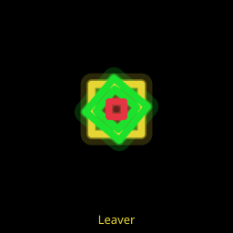 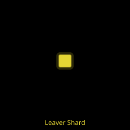

| Field | Detail |
|---|---|
| Type on the card | Splitter |
| Colour and shape | Nested squares: a green frame turned at an angle over a yellow square, with a red square inside. Its shards are small yellow, green and red pieces |
| Size | Leaver radius 14 u. Shard radius 7 u |
| Behaviour | Moves like a Weaver (190 u/s, dodges bullets). 2 hit points. When you destroy it, it splits into up to 6 shards. Each shard is flung out 40 u, holds still for 0.5 s, then chases you at about 201 u/s. Shards have 1 hit point |
| Tells | The shards pause before they chase |
| Counter | After the split, back away at once and shoot the shards as they come |
| Score and geoms | Leaver 100 and 2 geoms. Shard 25 and no geoms |
| First appears | Level 21, on about 60 percent of levels. Endless from 3:00. Weight 20, 18 in bands 3 and 4 |
| Notes | A Leaver removed by a bomb, your death or a well does not split. Shards do not count for destroy goals |
| Briefing | "Leavers look like Weavers, but split." / "Break one and its shards chase you." / "After you break one, back away at once." / "Shards are quick, so shoot as they come." |

### Sower and Mine

 

| Field | Detail |
|---|---|
| Type on the card | Hazard |
| Colour and shape | Sower: chartreuse notched hexagon. Mine: small chartreuse diamond with spikes |
| Size | Sower radius 16 u. Mine radius 9 u |
| Behaviour | The Sower heads for the nearest wall, then runs along it clockwise at 70 u/s and drops a Mine every 3.0 s. Now and then it dives toward the middle of the arena at a faster speed, still dropping Mines, then goes back to the wall. 4 hit points. A Mine is harmless for 0.8 s after it drops, then kills on contact. It lasts 12 s. 1 hit point |
| Tells | Mines are dim until armed |
| Counter | Hold the middle and kill the Sower early. Shoot Mines from range |
| Score and geoms | Sower 180 and 3 geoms. Mine 0, and it is not a kill |
| First appears | Level 31. Weight 10 in band 4. Ember also drops Mines |
| Notes | At most 6 live Mines per Sower and 24 in all. Mines are not pulled by wells |

### Spawner

| Field | Detail |
|---|---|
| Type on the card | Swarm |
| Colour and shape | Yellow octagon with a square inside |
| Size | Radius 24 u |
| Behaviour | Placed by the level. Creeps toward you at 50 u/s. 12 hit points. Emits Darts (section 11) |
| Counter | Kill it early. A bomb destroys it |
| Score and geoms | 150, 3 geoms |
| First appears | Level 16 |
| Briefing | "Spawners make Darts, again and again." / "They drift slowly after you." / "Break the Spawner before the flock." / "Then the Darts stop coming." |

### Gravity well

| Field | Detail |
|---|---|
| Type on the card | Hazard |
| Colour and shape | Red rings around a white core |
| Size | Radius 24 u, plus 2 u for each enemy it has eaten |
| Behaviour | See section 11 |
| Score and geoms | Shot down: 250 and 5 geoms. Exploding or bombed: nothing |
| First appears | Level 6 (0 to 1 per level in band 2) |
| Briefing | "Gravity wells pull you and shapes in." / "Left alone, they swell and burst bright." / "Shoot a well down early, from far away." / "When a big one breaks, a wave rolls out." |

### Geoms

 A geom: small lime green diamond. See section 4.

## 11. Hazards

### Gravity wells

| Rule | Value |
|---|---|
| At level start | Band 1: none. Band 2: 0 to 1. Band 3: 1 to 2. Band 4: 1 to 3. Guardian levels: at most 1. Endless: none |
| Arrivals | On a level that starts with a well, more arrive during play: the first 20 to 30 s in, then one every 25 to 35 s. An arriving well shows a 1.5 s warning, during which it is harmless, and lands at least 300 u from you. At most 2 more than the level started with, and never more than 4 at once |
| Pull | Within 320 u it pulls you, your bullets and most enemies. Strongest at the core (160 u/s on you), fading to nothing at the edge |
| Contact | Touching the core costs a life |
| Eating | An enemy whose centre enters the well is eaten (no score). Each meal adds 2 u of size and 2 hit points |
| Health | 40 hit points (changed by difficulty), plus 2 per meal. Any bullet that touches the core does 1 damage and is used up |
| Explosion | At 20 meals it explodes. Every enemy within 220 u is removed (no score), and you lose a life if you are in range and not invulnerable |
| Bomb | Shrinks it back to its starting size and health |
| Your death | Wells stay |
| Not pulled | Snakes, Spawners, Mines, Slime, drones, geoms, orbit spikes, a dashing Charger, a diving Sower, and anything still telegraphing |

### Super nova

5 to 7 s after a well goes live it erupts into a white whirlpool and stays that way until destroyed. Its pull reaches 400 u and is 30 percent stronger (208 u/s on you at the core). You can still escape it. A bomb shrinks it but does not end the nova.

### Nova snakes

3 to 4 s after a well goes super nova, a Snake crawls out of its centre, then another every 6 s, at most 2 alive per well. They are normal Snakes (200 points, 4 geoms) drawn with a white core line and a prism glint. When the well explodes it takes its nova snakes with it.

### Pond ripple

Destroy a well while it is in super nova (by shooting it, cutting it with orbit spikes, or letting it explode) and a ripple rolls out across the floor. There is no warning: you hear a deep thump and a watery whoosh. The wave travels out at 360 u/s for 3.2 s and pushes you and enemies outward as it passes. The push is stronger from a bigger well and changed by difficulty. Walls block it. Guardians, Spawners, Snake bodies, Mines and Slime are not pushed. A well destroyed before its nova makes no ripple.

### Spawners

| Rule | Value |
|---|---|
| How many | Band 3: 0 to 1 per level. Band 4: 1 to 2. None in bands 1 and 2, on guardian levels or in Endless |
| When | Appears 20 to 40 s in (band 3) or 10 to 30 s in (band 4) |
| Emit | 2.0 s after it appears it emits 5 Darts in a ring, then again every 6.0 s (band 3) or 5.0 s (band 4). It skips an emit while 16 of its Darts are alive |
| Survives | Your death. A bomb destroys it. Not pulled by wells |

### Membranes

Glowing bars that block you and your shots, found only in the rings map of drum levels (section 12): each ring of bars has 1 to 2 membrane pieces, 120 to 200 u wide. Enemies squeeze through slowly, at about a third of their speed. An enemy that crosses all the way through becomes enraged for the rest of its life: it turns hot red, moves 50 percent faster and turns 30 percent faster. Its attack timings do not change. Snake bodies, Mines and Slime are not affected. Wells, drones and guardians cannot pass.

### Slime

- Touching Slime slows you to 50 percent, and the slow lasts until 2 s after you leave the puddle.
- It does not stack: two puddles are still 50 percent.
- Bullets, drones and spikes pass through Slime. Wells do not pull it.
- A bomb clears every puddle. Your death clears them too.
- Splimes, Brood and Tempest leave Slime.

### Mines

Dropped by Sowers and by Ember. Harmless for 0.8 s, then deadly to touch. They last 12 s. One hit pops a Mine, for no score. A bomb clears them.

### Visual cues

| Cue | Meaning |
|---|---|
| Flashing outline | An enemy is about to spawn there |
| Grid ripples and bends | A kill, a death, a bomb or a super. Gravity wells pull a dimple into the grid |
| Walls pulse | Faster and warmer as the danger rises (Standard and High effects) |
| Hot red enemy | Enraged by a membrane |
| White whirlpool | A super nova well |
| Streaks across a drum | Drift is about to burst (section 12) |
| Bright, wide grid lines at the sides, shapes growing as they climb | A trough's rims (section 12) (new in tester-1+1c52828) |
| Violet dashed ring with rising specks | A Gravitas shelter pool, safe to enter (section 13) (new in tester-1+1c52828) |

## 12. Arenas and surfaces

### Flat arenas

- The arena is always shown whole, centred, with no scrolling.
- Shapes: rectangle, rounded rectangle, circle, hexagon, and a rectangle with wall bars (shown as "Pillars").
- Size grows with the band. Heights: 700 to 760 u (band 1), 760 to 880 u (band 2), 860 to 1000 u (band 3), 940 to 1100 u (band 4). Width is 1.3 to 1.8 times the height.
- Wall bars are 24 u thick: none in band 1, 1 in band 2, 1 to 2 in band 3, 1 to 3 in band 4 (on the wall bar shape only).
- Guardian levels are always flat.
- **Guardian arenas.** From level 10 every guardian level gets a bigger arena: at least 1600 x 1000 u for a rectangle, 1100 u across for a circle or hexagon. Spindle's is bigger still: at least 2080 x 1300 u, or 1430 u across. Brood at level 5 keeps its usual arena. (new in tester-1+1c52828)

### Drum levels (cylinder)

- The arena is drawn as a neon drum. It wraps left to right: fly off one side and you come back on the other. There are no side walls, only the top and bottom rims.
- **Level 8** is always a gentle open drum: only band 1 enemies, no drift, at most 1 well, no Spawners.
- **From level 11**, any non guardian level has a 40 percent chance to be a drum.

| Drum map | Share | What it is |
|---|---|---|
| Open | 30 | A plain drum with no bars. Has drift |
| Rings | 25 | 2 to 3 rings of bars round the drum, each with 1 to 2 gaps of 160 to 240 u and 1 to 2 membranes |
| Pillars | 25 | 6 to 10 staggered short pillars |
| Narrow | 20 | A drum about as wide as it is tall, with no bars. Has drift |

### Trough levels

- A trough is a flat rectangle whose ground is a valley across its width: the floor runs down the middle, and the ground rises toward the left and right walls, gentle near the floor and steep at the rims. The top and bottom are ordinary walls. (new in tester-1+1c52828)
- **From level 24**, a non guardian level that is not a drum has a 24 percent chance to be a trough. Two troughs never come in a row. (new in tester-1+1c52828)
- The pull acts on your ship only (section 7). It is changed by difficulty like drift. (new in tester-1+1c52828)
- A trough is at least 1.5 times as wide as it is tall. It has at most 2 wall bars and at most 1 gravity well, all on the floor, so the rims stay clear. Enemies arrive across the valley, not on the rims. (new in tester-1+1c52828)
- **Look.** Everything on a trough grows as it climbs, up to 1.35 times its size at the rim, as if the slope rose toward you. Grid lines and the arena outline get wider and brighter toward the rims. This is looks only: hit areas never change. (new in tester-1+1c52828)
- The start card names the arena "Trough" and its Details say "The ground slopes. Your ship slides toward the valley." (new in tester-1+1c52828)
- Free Play can turn its arena into a trough (section 14). (new in tester-1+1c52828)

### Drift

On drums with no bars (open and narrow, but not level 8) the floor flows. A steady current of 40 u/s runs round the drum. Every 9 to 14 s it bursts to 160 u/s for 1.5 s. 0.6 s before a burst you hear a warning sound and streaks run across the floor in the burst direction. You feel the full current, your bullets half and enemies a quarter. Push against it. Drift is stronger on harder difficulties (section 6).

### 3D tilt

Settings, 3D tilt: Off (default), Low (7 degrees) or High (13 degrees). It tilts the view of the arena, and the angle you see a drum from. It changes nothing in play.

## 13. Guardians

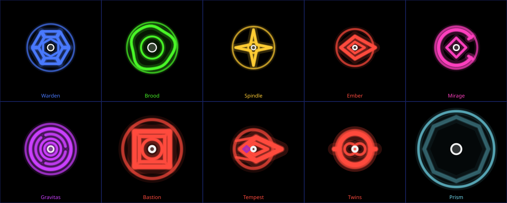

### Guardian levels

- Every 5th Adventure level is a guardian level.
- **Goal.** Survive until the guardian arrives at 1:25 on the wave clock, then defeat it. Before it arrives the goal bar reads "BOSS IN m:ss". After it arrives the goal bar reads "Defeat the boss" and the boss strip shows its name and its health bar (see Health bar below). A banner with its name fades in as it enters. (changed in tester-1+1c52828)
- **Win and lose.** You win the moment the guardian falls. You lose only when you run out of lives. There is no time out.
- **Entrance.** The guardian slides in from the far wall over 2 s. It is harmless and cannot be hit while it slides in.
- **Waves thin out** once the guardian enters: none on Easy, 25 percent of the usual waves on Normal, 50 percent on Hard and 60 percent on Insane. Before it enters the waves are as usual. (changed in tester-1+1c52828)
- **Holding out.** If the fight drags on to the level's hidden time limit (5:00 to 6:00 of wave clock), waves stop, the goal bar reads "Defeat the boss" and the guardian enrages. A guardian also enrages after 240 s alive. Enraged, it attacks 30 percent faster.
- **The arena** is flat, with no Spawners and at most 1 gravity well. From level 10 it is bigger than on other levels (section 12). Lives and bombs are as on any level. (changed in tester-1+1c52828)
- **Your death.** The guardian keeps its damage and its parts. Its attacks, minions and bullets are cleared, and its attack cycle restarts.
- **Reward.** A guardian kill gives a bonus of a quarter of the level's Normal par (rounded to 500) on every difficulty, not multiplied, plus 20 geoms. It counts as 1 kill. The results screen shows "Boss bonus N (<name> defeated)". (changed in tester-1+1c52828)
- **Easy and Insane.** On Easy a guardian has 0.55 times the health and attacks at 0.55 times the speed, with 0.75 times the minions. On Insane it has 1.62 times the health and attack speed, 1.6 times the minions, and its warnings are 15 percent shorter. Hard is between (section 6).
- **Getting stronger.** Guardians attack slower early on: x0.75 at level 5, rising to x1.0 at level 20 and x1.15 at level 50. The first guardian of a run (level 5) also has three quarters of its health.
- **After level 50.** The list starts again from Ember, with 25 percent more health each time round: Ember 55, Mirage 60, Gravitas 65, Bastion 70, Tempest 75, Twins 80, Prism 85, then Ember again at 90 with 50 percent more, and so on. These loops attack at the x1.15 rate.

### Rules for every guardian

- **Damage.** Guardians take damage in tenths of a hit: a spread or drone bullet 1 hit, rapid 0.7, pierce 6 (1.5 times its usual 4), an orbit spike 1.5 (then that spike rests 0.25 s), the Ram drone 2. Any bullet stops on a guardian's body. (changed in tester-1+1c52828)
- **Armour.** Very tough guardians spread their health over armour, so their bar drops more slowly per hit. Detonate ignores armour.
- **Health bar.** The bar has two strips: a blue Shield strip on top and a red Health strip under it. The Shield strip holds the top 34 percent of the guardian's health and empties first. The guardian cracks the moment it is empty, and the strip dims. Then the Health strip drains; the second crack comes halfway down it. Gravitas and Tempest carry their remaining health into their parts, so the bar runs on. Brood's Broodlings get a full bar of their own. (new in tester-1+1c52828)
- **Phases.** A 2 phase guardian changes at half health; a 3 phase one at two thirds and one third; Prism at 75, 50 and 25 percent. A guardian with a fury starts phase 2 at its break instead. Each change pauses its attacks for 1 s. (changed in tester-1+1c52828)
- **Cracks.** When the Shield strip empties (below 66 percent health) its outline cracks; below 33 percent it cracks further and a piece breaks off. The cracks glow brighter as its health drops. Gravitas and Tempest split into smaller parts at the second crack. Brood splits when both its strips are empty. The Twins crack only once their shared Shield strip is gone. (changed in tester-1+1c52828)
- **Fury.** Warden, Spindle, Ember, Mirage and Gravitas have a fury. When the Shield strip empties the guardian breaks: for 4.5 s it stands still, shakes and flashes, its attacks and Hornets clear, its core closes, and no hit hurts it. Then it is enraged until it falls: it changes colour and its attacks change (see each guardian below). Your death does not end the fury. Brood has no fury of its own; its Broodlings go into a frenzy instead. (new in tester-1+1c52828)
- **Hit feedback.** A shot that hurts a guardian, or one of its parts, flashes its body white for an instant, throws sparks in its colour and plays a soft tick. A blocked shot throws one small grey spark and a duller, quieter thunk. (new in tester-1+1c52828)
- **Warnings.** Every attack shows a warning first (1.0 s on early guardians, 0.8 s on Ember, Mirage and Gravitas, 0.6 s on the rest), during which it is harmless. An attack that would appear right on you waits 0.3 s.
- **Shots.** Every guardian also fires a volley every 5 to 6.5 s, cycling an aimed fan, a ring burst and a pincer, more bullets each phase. Guardian bullets fly straight, at most 240 u/s, and are only fired while you are at least 300 u away.
- **Contact.** Touching a guardian's body, its split parts or its Hornets costs a life. Pods, anchors, turrets and Mirrors are safe to touch.
- **Bomb.** Clears its attacks, minions and bullets and stuns it for 1.5 s. While stunned it does not move or attack, and its weak state stays as it was. No damage.
- **Detonate.** If the drone is within 260 u of its body, it loses 10 percent of its full health, through any shield. Detonate cannot hit split parts or pods.
- **Homing.** Your bullets home on the guardian's body and on every part, pods and Hornets included.
- **Turbo.** Bullets pass through parts but still stop on the body. Killing parts does not extend Turbo; killing ordinary enemies does.

### Brood, Keeper of the Nest (level 5)

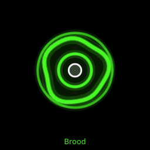

| Field | Detail |
|---|---|
| Health | Body 340 hits on Normal, then 3 Broodlings of 45 hits each. Three quarters of both on its first fight at level 5 (changed in tester-1+1c52828) |
| Phases | 2 (phase 2 below half health) |
| Movement | Prowls toward you at 75 u/s (90 in phase 2) for 3 s (2.2 s in phase 2), then charges |
| Attacks | Charge: a lane warning for 1.0 s, then a charge at 320 u/s (360 in phase 2) for up to 1.8 s or until it hits a wall, then a 0.6 s recovery. Darts: 3 every 6 s (4 every 5 s in phase 2) |
| Weak state | Immune while any of its 3 pods lives. The pods circle at 90 u and pop in 1 hit. Break all three and its core opens for 5 s: it flees and never charges. Pods regrow 9 s after the last one broke |
| Split | When both its strips are empty its body and pods vanish and 3 Broodlings appear, flashing white. They get their own full bar, labelled "Broodlings". One chases you, one circles you and lays Slime, one keeps away and fires 2 Darts every 4 s. Touching any Broodling costs a life. The fight ends with the third (changed in tester-1+1c52828) |
| Frenzy | When the first Broodling dies the others go into a frenzy: hot green with red cores, 1.25 times faster. Every 4 s two of them close on you from opposite sides: each stops for 0.8 s, flashing white, with a green aim line to a point 140 u past you, then drives through that point at 320 u/s for up to 1.2 s. A lone survivor keeps the speed and hunts you (new in tester-1+1c52828) |
| Counter | Break the pods fast, then pour fire into the core. Step off the charge lane. In the frenzy, move off the line between the two aim lines before they drive (changed in tester-1+1c52828) |
| Intro | "Brood, Keeper of the Nest, wakes." / "It kept small shapes safe and warm." / "A fallen legend took its green light." / "Now it guards its nest from everyone." / "Three pods shield it. Break all three," / "then strike. Step off its charge line." / Torus: "It is not cruel, {callsign}. It is lost." |
| Freed | "Green light returns. Brood is free." / "One star wakes. Vertane remembers you." |

### Warden, Keeper of the Old Gate (level 10)

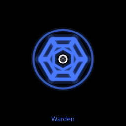

| Field | Detail |
|---|---|
| Health | 519 hits on Normal (changed in tester-1+1c52828) |
| Phases | 2 |
| Movement | Seeks you at 55 u/s |
| Attacks | Rings: every 3.7 s (2.8 s in phase 2) it sends out a ring with a 70 degree gap facing you, growing at 300 u/s. In phase 2 each ring has a second gap on the far side. Shield and swarm: 10 s into the fight and every 14 s after, it stops, raises a shield for 4 s and releases 10 Hornets in two bursts. In phase 2 the dropping shield also fires a ring of 12 bullets |
| Hornets | Small, 1 hit, 300 u/s. They fly straight for 0.35 s, become deadly at 0.6 s and fade at about 5.4 s. 8 on Easy, 13 on Hard, 16 on Insane |
| Weak state | Its core is shut except for 2.0 s after each ring's warning ends, and 2.0 s after the shield drops |
| Fury | When its Shield strip empties it breaks for 4.5 s, growing corner spikes as it turns hot red, then stays enraged with a slow pulse: it seeks at 80 u/s, rings come every 2.4 s, and it adds a dash charge. 3 s after the break, then every 8 s, it stops and aims for 0.8 s (a blinking red dashed line shows the way), dashes at 300 u/s for up to 1 s or until a wall, fires a ring of 12 bullets where it stops and opens its core for 2 s. It never dashes while its shield is up (new in tester-1+1c52828) |
| Counter | Fly through the gap in each ring, then shoot during the 2 s opening. Clear Hornets with spread or a bomb. Enraged, step off the aim line, then punish the open core after the dash (changed in tester-1+1c52828) |
| Intro | "Warden, Keeper of the Old Gate." / "It once opened the ways between places." / "The fallen legend broke its trust." / "Now it shuts every way, for everyone." / "Fly through the gap in its rings." / "Its shell opens just after each ring." / Torus: "A closed gate still remembers the key." |
| Freed | "Blue light returns. The Old Gate opens." / "Far off, a grey shape watches, and goes." |

### Spindle, Turner of Days (level 15)

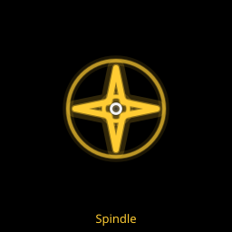

| Field | Detail |
|---|---|
| Health | 1,350 hits on Normal (changed in tester-1+1c52828) |
| Phases | 2 |
| Movement | Circles the arena centre at 200 u |
| Attacks | Sweep arms: 2 arms (3 in phase 2), 380 u long, turning round it. Every 5 s the arms freeze thin and dim for the warning, then turn the other way. Pellet: 1 bullet every 3.0 s (3.6 s in phase 2), never during an arm warning. Needles: each arm tip flings a bullet along its sweep every 1.2 s, never from a tip within 150 u of you and never while the arms are frozen (changed in tester-1+1c52828) |
| Fury | When its Shield strip empties it breaks for 4.5 s, then stays enraged: its arms turn hot red, a fourth arm joins, each sweep turns at its own speed, the arms reverse every 3 s and needles fly every 0.9 s (new in tester-1+1c52828) |
| Weak state | Always open |
| Counter | Stay in the open space between the arms. When they go dim, get ready for them to turn back |
| Intro | "Spindle, Turner of Days." / "It turned the hours of Vertane gently." / "The fallen legend tangled its turning." / "Now its arms sweep only to push away." / "Stay in the open space between its arms." / "When the arms go dim, they turn back." / Torus: "A legend came before you. Remember that." |
| Freed | "Yellow light returns. Days turn again." / "Somewhere, a grey legend loses a little." |

### Ember, the Hearth Flame (level 20)

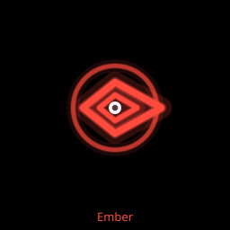

| Field | Detail |
|---|---|
| Health | 822 hits on Normal (changed in tester-1+1c52828) |
| Phases | 3, each faster than the last |
| Attacks | Dash: it winds up behind a lane warning, then dashes at 760 u/s (faster each phase), dropping a Mine every 120 u. It bounces off up to 2 walls; a third wall stuns it. Fan: after a dash that ends in open floor it fires 3 bullets 14 degrees apart |
| Weak state | Can be hit only while it rests or is stunned. A dash that touched a wall ends in a 2.0 s stun. A dash that ends in open floor ends in a rest of 1.8 s (shorter each phase) |
| Leavers | Every stun releases 2 enraged Leavers at its body, at most 4 of its Leavers alive at once (new in tester-1+1c52828) |
| Fury | When its Shield strip empties it breaks for 4.5 s, then burns as a blue flame pulsing blue, purple and white: its dash is 1.2 times faster, it bounces off up to 3 walls and each stun releases 3 Leavers (new in tester-1+1c52828) |
| Counter | Stand near a wall so it dashes into one, then hit it during the stun. Shoot the Mines it leaves, and back away from the Leavers it releases (changed in tester-1+1c52828) |
| Intro | "Ember, the Hearth Flame." / "It kept all of Vertane warm." / "The fallen legend fed on its fire." / "Now it burns wild and cannot rest." / "It dashes and drops mines on the way." / "Hit it when it stops after a wall." / Torus: "Help it rest, and it will warm you." |
| Freed | "Orange light returns. Vertane is warm." / "Two acts of the trial are done." |

### Mirage, Keeper of True Sight (level 25)

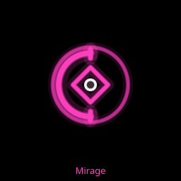

| Field | Detail |
|---|---|
| Health | 1,150 hits on Normal (changed in tester-1+1c52828) |
| Phases | 3 |
| Attacks | Warp: every 3.0 s (2.5 s, then 2.0 s by phase) it warps to a spot 200 to 300 u from you. A ring marks the spot 0.5 s early. It will not land while you are close to the spot. Lanes: on landing it fires 8 lanes outward, 600 u long, each with a 0.8 s warning. One lane always runs through where you are (changed in tester-1+1c52828) |
| Weak state | Its shield lets hits through only a 180 degree open arc that turns slowly round it. Shots that land elsewhere do nothing (changed in tester-1+1c52828) |
| Mirrors | At the second crack it leaves 2 Mirror copies on its last two landing spots. They pop in 1 hit, are safe to touch and come back every 6 s |
| Fury | When its Shield strip empties its mirror ring shatters and it breaks for 4.5 s, then stays enraged with a flickering double image and a white hot edge. Every warp now shows 3 landing rings at least 120 u apart. Only one is real; the false rings vanish 0.2 s before the landing (new in tester-1+1c52828) |
| Counter | Move off the ring, step out of the lane aimed at you, and time shots into the open arc. Enraged, keep clear of all three rings (changed in tester-1+1c52828) |
| Intro | "Mirage, Keeper of True Sight." / "It showed Vertane what was real." / "The fallen legend taught it to trick." / "Now it shows only what is not there." / "A ring shows where it will land. Move." / "Shoot through the gap in its shield." / Torus: "When it sees true, you will see too." |
| Freed | "Magenta light returns. Mirage sees true." / "And it shows you what really happened." / "A legend named Vecta took their light." / "He wanted all of it for himself." |

### Gravitas, Heart of the Deep (level 30)

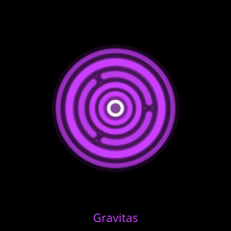

| Field | Detail |
|---|---|
| Health | 1,704 hits on Normal (changed in tester-1+1c52828) |
| Phases | 3 |
| Movement | Seeks you at 45 u/s and pulls you toward it within 300 u (up to 100 u/s). The pull never kills by itself |
| Attacks | Collapsing rings: a ring starts at 480 u and closes in at 220 u/s with a 60 degree gap facing you, every 5 s (4 s, then 3 s by phase) |
| Weak state | It takes no damage until all 3 anchors are gone. Anchors circle it at 140 u and take 6 hits each. Each lost anchor weakens the pull by a third. Anchors never regrow, even after you die. Then the core stays open |
| Split | At the second crack it splits into 2 Gravitants that share its remaining health, circling a shared centre that follows you. Each has its own pull. The rings keep closing on them. Touching a Gravitant costs a life (changed in tester-1+1c52828) |
| Fury | When its Shield strip empties it breaks for 4.5 s, collapsing to a point and swelling back, then stays enraged, violet with a spinning white ring. Tide: every 4 s its pull flips to a push of the same strength and back, and a ring flashes on its body 0.8 s before each flip. Shelter pools: every 3 s it leaves a violet pool of radius 80 u where it stands. A pool lasts 8 s and shrinks away over its last 2 s; at most 4 are out at once. Inside a pool there is no pull or push, and your ship floats (section 7). After the split the tide and the pools follow the pair (new in tester-1+1c52828) |
| Counter | Shoot the anchors first. Fly out through each ring's gap. Fight the pull by moving away. Enraged, shelter in a pool when the tide turns against you (changed in tester-1+1c52828) |
| Intro | "Gravitas, Heart of the Deep." / "Its pull held all of Vertane together." / "Vecta made its pull too strong." / "Now it pulls everything to itself." / "Break its three anchors to weaken it." / "Fly out through the gap in each ring." / Torus: "No more riddles. I am with you." |
| Freed | "Violet light returns. The heart is calm." / "Vertane holds together again." / "And now you see him, far on the rim." / "Vecta, the Grey Legend, sees you too." |

### Bastion, the Last Wall (level 35)

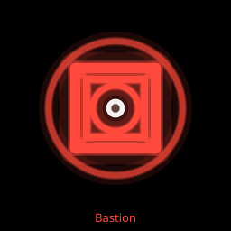

| Field | Detail |
|---|---|
| Health | 1,833 hits on Normal (changed in tester-1+1c52828) |
| Phases | 3, set by its turrets, not its health |
| Movement | Holds the centre and turns slowly |
| Attacks | 4 corner turrets (30 hits each) act in turn, one every 1.125 s, each firing a lane (600 u long) or a bullet, alternately. Bulwarks: 1 every 12 s (2 on Insane) |
| Weak state | With 3 or 4 turrets standing the core is shut. With 1 or 2 left it is phase 2 and the core opens. Each turret you destroy also takes 5 percent off its health bar, and shields the others for 1.5 s. A fallen turret rebuilds at half health 12 s later, one at a time, while the core is above a third of its health |
| Woken (no turrets left) | It drifts toward you at 50 u/s with a 230 u sweep arm and charges every 5 s (3.5 s after the second crack). Every 10 s it raises a 3 s shield and releases 8 Hornets (6 on Easy, 10 on Hard, 13 on Insane), then holds still with its core open for 2 s. Otherwise the woken core is open |
| Counter | Break two turrets fast and hit the core before they rebuild. Kill the Bulwarks from behind |

### Tempest, Rider of the Rim (level 40)

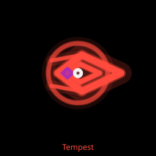

| Field | Detail |
|---|---|
| Health | 1,832 hits on Normal (changed in tester-1+1c52828) |
| Phases | 3 |
| Movement | Laps the arena close to the wall at 140 u/s, laying Slime every 1 s |
| Attacks | Dash: every 5.0 s (4.2, then 3.3 by phase) a 0.6 s lane warning across the floor, then a dash at 600 u/s to the far wall, then a 1.5 s rest |
| Weak state | Open while it laps and rests. Shut during the wind up and the dash |
| Split | At the second crack it splits into 2 Tempestlings that share its remaining health. They take flanking spots 260 u from you, then dash at you from two sides every 2.6 s, and after each dash fire a fan of 6 bullets back along the path. They lay Slime. Touching one costs a life |
| Counter | Step off the dash lane, shoot while it laps, and bomb to clear the Slime |

### The Twins, the Bound Stars (level 45)

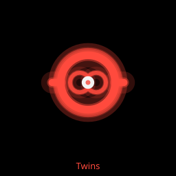

| Field | Detail |
|---|---|
| Health | 2,250 hits on Normal, shared by both bodies on one bar (changed in tester-1+1c52828) |
| Phases | 2 |
| Movement | Two bodies circle the centre on opposite sides. The space between them breathes from 300 to 500 u |
| Attacks | Tether: a deadly bar joins them whenever they are at least 250 u apart. Rings: one every 3.5 s, from each body in turn, with a 60 degree gap facing you |
| Weak state | Both bodies can always be hit |
| Phase 2 | When the first body falls the tether breaks. The survivor moves 40 percent faster and fires a ring every 4 s |
| Counter | Never cross the bar. Focus one body to break the tether early |

### Prism, Crown of All Colours (level 50)

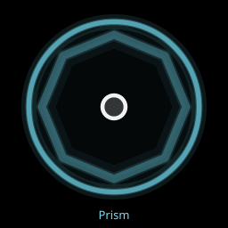

| Field | Detail |
|---|---|
| Health | 844 hits on Normal (changed in tester-1+1c52828) |
| Phases | 4 (at 75, 50 and 25 percent) |
| Movement | Drifts between 4 points on the diagonals at 90 u/s |
| Weak state | It cycles every 4 s: 2.3 s guarded in colour, 0.5 s turning white, then 1.2 s white. While white it takes full damage; otherwise only a quarter of each hit gets through |
| Attacks | Phase 1: rings with a 60 degree gap every 3.5 s, plus 3 small pods. Phase 2: 2 sweep arms and a lane at you every 2.5 s. Phase 3: a pull, and a warp every 3.5 s with a ring marker, then 4 lanes. Phase 4: 4 turrets firing lanes in turn and a tether from its body to the arena centre. Each phase change clears the last phase's attacks |
| Counter | Save your heaviest fire for the white window. Each phase uses another guardian's trick, so read it the same way |

### Guardians in Endless and Free Play

- **Endless.** A guardian arrives every 3 minutes of play (segments 6, 12, 18 and so on), 10 s into the segment. The order is Brood, Warden, Spindle, Ember, Mirage, Gravitas, Bastion, Tempest, Twins, Prism, then from Ember again with more health. The wave clock stops while the guardian lives. The HUD label reads "Boss". A kill gives 5,000 points per guardian tier (Warden, Brood and Spindle tier 1; Ember, Mirage and Gravitas tier 2; Bastion, Tempest and Twins tier 3; Prism tier 4), plus 20 geoms. (changed in tester-1+1c52828)
- **Free Play.** The Bosses row offers Off (default), "Every 2 min" or one guardian by name. With "Every 2 min", guardians come one at a time in the Endless order: the first at 2:00 of wave clock, then each next one 2 minutes of wave clock after the last one falls. With one guardian chosen, the first arrives at 1:40 of wave clock, then one every 5 minutes. Every guardian can fight on a drum in Free Play. Kill bonuses are as in Endless. (changed in tester-1+1c52828)

## 14. Endless and Free Play

### Endless

- A fixed 1600 by 1000 u flat rectangle. No gravity wells, no Spawners. Attack drone and Turbo super, always.
- Pick a difficulty on the start card. The card reads "Endless" and "Survive as long as you can". Then a 1.5 s "Ready" lets your thumbs settle.
- A fresh seed every game, shown on the HUD line ("Endless  Seed N  m:ss") and the results.
- 3 lives at start (changed by difficulty) and 3 bombs, each capped at 9.
- **Extra lives** at 200,000 points, then 600,000, 1.4 million, 3.0 million, 6.2 million and so on: each gap is double the last.
- **Extra bombs**: 1 every 150,000 points.
- The game ends when your last life is gone. The results show "Game over", your score and "New high score" or "Top 10: #n" when it makes your table. The table keeps your top 10.

**The ramp.** Every 30 s of wave clock a new segment starts with its own roster and waves. Segment s plays like Adventure level 1 + 2s.

| Wave clock | Plays like | What changes |
|---|---|---|
| 0:00 | Level 1 | Grunt, Wanderer, Pinwheel |
| 1:30 | Level 7 (band 2) | Weaver, Dart, Charger, Swirl and Splime can appear. Speed x1.05 |
| 3:00 | Level 13 | Leavers can appear from here. The first guardian, Brood, arrives at 3:10 (changed in tester-1+1c52828) |
| 4:00 | Level 17 (band 3) | Snake, Bulwark and Blink can appear. Speed x1.10 |
| 7:30 | Level 31 (band 4) | Sower can appear. Speed x1.20. From here every segment adds one more enemy per wave, with no limit |
| 17:30 | Level 71 | Speed reaches its cap of x1.40 |

The music changes tune every 90 s.

### Free Play

Free Play is on the main menu. It opens a setup screen: "Endless waves on your rules. No stars, no bests." Your last setup is remembered.

| Section | Row | Choices | Default |
|---|---|---|---|
| Difficulty | | Easy, Normal, Hard, Insane | Normal |
| Arena | Arena surface | Flat, Trough | Flat (new in tester-1+1c52828) |
| Arena | Arena | Rectangle, Circle, Drum (fixed while the surface is Trough) | Rectangle (changed in tester-1+1c52828) |
| Arena | Size | Small, Medium, Large | Medium |
| Arena | Barriers | On, Off | Off |
| Enemies | Kinds | A button for each of the 13 enemy kinds, plus All and None | None picked, which plays every enemy (the normal Endless mix) |
| Enemies | Density | Low, Normal, Swarm | Normal |
| Rules | Lives | 1, 3, 5, ∞ | 3 |
| Rules | Length | Endless, 3 min, 5 min, 10 min | Endless |
| Loadout | Weapon | None, Spread, Rapid, Pierce, Orbit | None |
| Loadout | Pickups | On, Off | On |
| Loadout | Drone | Attack, Collect, Ram | Attack |
| Loadout | Super | Homing, Detonate, Turbo | Turbo |
| Hazards | Bosses | Off, Every 2 min, or one guardian | Off (changed in tester-1+1c52828) |
| Hazards | Wells | Off, Normal, Many | Normal |
| Hazards | Drum drift | Off, Low, High (shown only for Drum) | Low |

- **Arena surface.** Trough turns the arena into a trough (section 12), always a rectangle, so the Arena row is greyed out and a note says "Trough is always a rectangle, so the shape is fixed." Size still applies. Barriers place 2 bars on the floor, and the Wells row places at most 1 well. (new in tester-1+1c52828)
- **Size.** Small is 0.75 times and Large 1.3 times Medium. The Medium rectangle is 1600 by 1000 u.
- **Barriers.** 2 to 3 bars on a rectangle or circle. A drum gets rings or pillars.
- **Density.** Low 0.6 times, Swarm 1.95 times the enemies (and a higher cap).
- **Lives.** Exactly as picked; difficulty does not change them. With ∞ the run never ends, but deaths still reset the multiplier.
- **Length.** A timed run ends at its time with "Time up". Endless runs until your lives are gone.
- **Weapon.** Start holding that weapon for 20 s. With Pickups Off it lasts the whole run.
- **Wells.** Normal places 1 to 2, Many places 2 to 4, and more arrive twice as often.
- **Bosses.** Every 2 min brings one guardian at a time: the first at 2:00, then 2 minutes after each one falls (section 13). (new in tester-1+1c52828)
- **Drum drift.** High is twice Low. Drift runs only on a drum without barriers.
- Snakes, when allowed, come at least 3 per segment.
- Free Play starts with a 1.5 s "Ready". It saves no scores, stars or bests.

## 15. Strategy

### Beginner

1. **Keep your thumbs down.** The sticks float and follow, so you never need to look for them. Lifting the right thumb stops fire.
2. **Back away while firing.** Grunts and Weavers fly straight at you.
3. **Grab geoms.** Each one is plus 1 multiplier and plus 1 super charge. They vanish after 4 s.
4. **Bomb early, not late.** You get 3 per level and they do not carry over.
5. **Watch the flashing outlines.** An enemy goes live there in 0.6 s.
6. **Use the 2 s after a respawn.** You blink and are invulnerable.
7. **Try Easy first.** You get 5 lives. Move up when a level feels easy.

### Intermediate

1. **Protect the multiplier.** Only death resets it.
2. **Build combos.** After your first pickup the next one is due within 12 kills. Two weapons make a combo for a fresh 20 s.
3. **Match weapon to enemy.** Pierce, Trident and Needle cut lines of enemies. Rapid and Hail catch Weaver sidesteps. Orbit's chainsaw shreds anything in front of you.
4. **Read the Charger lane.** Step out sideways, then punish the rest.
5. **Flank the Bulwark.** Its shield covers 120 degrees at the front and it turns only 70 degrees a second.
6. **Back off from a Leaver kill.** Its shards wait 0.5 s, then chase.
7. **Kill Spawners first.** It takes 12 hits, and it emits 5 Darts every 5 to 6 s until it dies.
8. **Watch the clock colours.** Yellow is one minute left, red is ten seconds.

### Advanced

1. **Shoot wells for 250 times your multiplier.** At x100 that is 25,000 plus 5 geoms. Shoot them before they go super nova, or be ready for the ripple.
2. **Use the ripple.** A super nova well's ripple pushes enemies twice as hard as it pushes you.
3. **Save Detonate for a crowd or a guardian.** It scores every kill within 260 u of the drone and takes 10 percent off a guardian.
4. **Chain Turbo.** Every kill adds 0.25 s, up to 15 s. Its bullets pass through 2 enemies.
5. **Beat par for a reward.** An extra life on the next level is worth a lot before a guardian.
6. **Score missions run the full clock.** Hitting the target early does not end the level.
7. **Go for the fourth star.** Any Insane win gives 4 stars, whatever your score.

## 16. Settings reference

Settings opens from the menu and from the pause screen. The panel sits on the left; opened from the menu, a live demo arena runs on the right.

| Setting | Range | Default | Effect | Notes |
|---|---|---|---|---|
| Neon | 0 to 100 slider | 70 | Glow and colour strength: bloom strength 0 to 2, bloom threshold 0.8 to 0.2, colour saturation 0.4 to 1.3, glow width 0 to 0.9, grid brightness 0.1 to 0.6 | Changes live while you drag. Saved when you lift your finger |
| Volume | 0 to 100 slider | 70 | Master volume for all sound | Changes live |
| Music | 0 to 100 slider | 50 | Music level. 0 is off | Music never goes above 35 percent of the master |
| Weapon pickups | On, Off | On | Whether kills drop weapon and drone pickups, section 8 | |
| Effects | Low, Standard, High | Standard | Low: no trails, no wall effects, 2048 particles. Standard: trails and wall effects, 2048 particles. High: 4096 particles | The main frame rate setting |
| 3D tilt | Off, Low, High | Off | Tilts the arena view by 0, 7 or 13 degrees, section 12 | Looks only |
| Show FPS | On, Off | Off | Shows a frame rate readout at the top | Use it to check the other settings |
| Glow | Bloom, Fallback | Bloom | Bloom uses a full screen glow pass. Fallback uses glow sprites instead | Neon works on both |
| Run seed and Play seed | 0 to 4294967295 | empty | Plays level 1 of the typed seed | Session only: it unlocks nothing, records no bests and saves no reward. The line under the box says "Type a run seed (0 to 4294967295)", "Not a valid seed", or the seed and its level 1 code |
| Reset progress | Two taps within 3 s | | The first tap reads "Tap again: clears levels, story and call sign", the second "Progress, story and call sign reset". Sets the unlocked level back to 1, clears Adventure bests and stars, drops a held par reward, and clears your call sign and the record of story scenes seen, so the opening plays again | Keeps your settings, run seed, Endless top 10, Free Play setup and last difficulty (changed in tester-1+1c52828) |
| Back | | | Closes Settings | |

At the bottom a small label shows the build. Difficulty and space physics are not settings: difficulty is picked on each start card, and space physics follows it.

If the game stutters: turn Show FPS on, try Effects Standard or Low, then try Glow Fallback.

## 17. Music and sound

All sound is made live by the game. There are no recordings.

### Sound effects

| Sound | When |
|---|---|
| Short blip | You fire (at most 12 a second) |
| Noise burst | An enemy dies |
| Deep crash | A big kill: Snake head, Spawner or gravity well |
| High chirp | A geom is collected (at most 20 a second) |
| Spawn tick | An enemy starts to telegraph, and a drift burst warning |
| Long rumble | A bomb or a Detonate |
| Falling saw and noise | You die |
| Respawn tone | You come back |
| Super sounds | Your super is full, and when you fire it |
| Rising tone | A level starts |
| Win and lose stings | On the results screen |
| Tap | Menu buttons |
| Saw buzz | The orbit chainsaw |
| Whirlpool roar | A super nova well |
| Whoosh and thud | A gravity well arriving; a slither when a well releases snakes |
| Thump and watery whoosh | A pond ripple |
| Shield hum, chord and pings | A guardian's shield going up and shattering |
| Guardian rumble, shots and death | A guardian enters, fires and falls (changed in tester-1+1c52828) |
| Soft tick | Your shot hurts a guardian or one of its parts. A duller, quieter thunk means the shot was blocked (new in tester-1+1c52828) |
| Scroll blip | Scrolling Settings, How to and other panels |

### Level music

- Ten tunes, each in its own key, speed and mode. A level always gets the same tune. Back to back levels never share one, and a run hears every tune once every 10 levels.
- The first breakdown comes 30 to 45 s into a tune, then every 90 to 120 s, 4 bars long.
- In Endless the tune changes every 90 s.

### Threat music

The music follows what is in the arena, so you can read the game by ear. Every live enemy adds weight; threat is the total divided by 40, capped at 1. It rises over about 0.5 s and falls over about 3 s.

| Threat | Layer that enters |
|---|---|
| 0 | Soft pad only, filter dark |
| 0.06 | Bass |
| 0.12 | Arpeggio |
| 0.20 | Kick |
| 0.32 | Hi hat |
| 0.7 and up | The lift: hi hat doubles, a clap joins, the arpeggio jumps an octave and the filter opens wide. It drops out again below 0.6 |

### Enemy motifs and kill notes

- When a kind enters the arena you hear a short stinger, then its two bar motif joins on the next bar. It leaves 2 bars after the last of that kind is gone.
- Motifs: Grunt a steady low pulse; Wanderer a drifting walk; Weaver off beat steps; Pinwheel a rotating four note cycle; Dart fast high runs; Snake long sliding notes; Charger a rising wind up; Bulwark a heavy low pair; Blink bright staccato pairs; Swirl a looping spiral; Sower sparse high ticks; Splime a slow wobbling glide; Leaver off beat steps, then a falling three note break.
- Kills answer the beat with notes from the current chord: up to 3 a bar when calm, up to 6 when crowded. Three kills in one beat, a big kill or a bomb plays a full chord.
- A hit that does not kill plays a quiet tick. A shot blocked by a Bulwark shield plays a metallic ping: move to its side.

### Guardian music

- Three battle tracks. A fight never uses the same track as the fight before it in your run.
- The music crossfades into the battle track as the guardian enters. Each guardian has its own motif, which gains a voice each phase and loses one at each crack.
- A rising cue sounds as its weak window opens, with a shimmer while it stays open.
- When it falls, a victory stinger plays and the level tune returns 2 bars later.

### Turbo music

Turbo starts with a 0.4 s rising sweep, then a double time layer (fast arpeggio, pumping bass, light hat) plays over the tune with an engine hum. A falling sweep ends it.

### Weapon and drone cues

Combining weapons plays a rising three note chime; a weapon running out plays a falling one. Drone pickups use the same shapes, higher and softer.

### Menu music

Three menu themes play in turn: a new one each time the game starts and each time you come back to the menu from a level. They play on the title, the menu, Level select and the Free Play screen. Settings keeps whatever is playing. Set Music to 0 to silence them.

### Story sounds

A soft rising tone opens the opening and briefings. A low drone plays under a guardian intro. A warm chord blooms when a guardian is freed. Each new panel makes a quiet shimmer. Skip fades the sound out.

### Time warnings

A soft chime at 1:00, another at 0:30, and a low tick each second from 0:05, slightly louder at 3, 2 and 1 (section 5).

## 18. Install and device

- **Where to play.** Open https://play.shapelegend.com in your phone's browser. The game is played from this web address. It works on Android phones and iPhones as well as the Galaxy Z Fold.
- **Add it to your home screen** from the browser's menu (for example "Add to Home screen" or "Install app"), then launch it from the icon. It runs fullscreen in landscape.
- **Start.** A 1.2 s splash shows the title (tap to skip), then "Tap to start". That tap turns on sound and asks for fullscreen and landscape. If the phone will not lock landscape, the game still plays.
- **Offline.** After the first load the game is stored on the phone and runs with no connection. Updates install themselves.
- **Where progress lives.** Everything is stored on the phone, in the browser's storage for the game: your run seed, unlocked level, Adventure bests and stars, the Endless top 10, the Free Play setup, your call sign, the story scenes you have seen, and every setting. Nothing is sent anywhere.
- **Old address.** If you open the game at its old address, a strip on the menu points you to play.shapelegend.com. Progress at the old address does not carry over.
- **Resetting.** Settings, Reset progress (tap twice) sets the unlocked level to 1, clears Adventure bests and clears the story and your call sign (section 16). To wipe everything, clear the site's data in your browser settings. (changed in tester-1+1c52828)
- **Version.** The main menu footer reads "Shape Legend v0.9.0 (build <code>)". Quote it when you report a bug. (new in tester-1+1c52828)

### For testers

These are left in the game for testing. Since tester-1+1c52828 most of them show only in a tester session: add ?dev=1 to the game address, or use a tester build. (changed in tester-1+1c52828)

- For everyone: the results Details show the "Level code" ("#" and 8 characters), and the start card Details show the seed. Two players on the same seed and level get the same code.
- Tester session only: the HUD level line ends with the level code. (changed in tester-1+1c52828)
- Tester session only: a two finger long press of 1 s near the top left corner opens a small debug panel with Show FPS and Glow toggles. (changed in tester-1+1c52828)
- Tester session only: tapping the build label at the bottom of Settings 5 times within 3 s shows a stress test button. It starts a test level. (changed in tester-1+1c52828)
- Tester session only: Settings shows "Unlock all levels". Tap it twice ("Tap again: unlock levels 1 to 50") to unlock levels 1 to 50. Stars and scores are not touched. (new in tester-1+1c52828)
- Tester session only: when a guardian falls, a line with the fight time shows for 6 s and again on the results, for example "Warden 1:05 (to break 0:31, break 0:05, enraged 0:29)" or "Brood 1:52 (body 0:58, Broodlings 0:54)". Paused time does not count. (new in tester-1+1c52828)
- Guardian levels are built by generator version 14 and trough levels by version 12; other levels are unchanged. (new in tester-1+1c52828)
- The Android test app ships no offline copy of the web game and drops one left by an old install on first launch. Android backup keeps your progress but leaves out that offline copy. (new in tester-1+1c52828)

## 19. Glossary

| Term | Meaning |
|---|---|
| Arena unit (u) | The game's distance unit. The ship's hitbox radius is 10 u |
| Band | A level range: 1 to 5, 6 to 15, 16 to 30, 31 and up. Sets enemies, arena size and speed |
| Bomb | Clears the arena with no score. 3 per level |
| Call sign | Your pilot's name, picked in the opening |
| Combo | Two weapons joined into one, for example Hail |
| Cover screen | The Fold's outer, wide screen |
| Drift | The flowing floor of an open drum |
| Drone | Your helper: Attack, Collect or Ram |
| Drone pickup | A ring that gives your drone a mode for 20 s |
| Drum | A cylinder arena that wraps left to right |
| Enraged | Faster after crossing a membrane (enemies), after a long fight (guardians), or after a guardian's fury break (changed in tester-1+1c52828) |
| Fury | A guardian's second form: a 4.5 s break when its Shield strip empties, then enraged until it falls (new in tester-1+1c52828) |
| Geom | Lime green diamond dropped by kills. Plus 1 multiplier, plus 1 super charge |
| Guardian | A boss. Every 5th Adventure level |
| Level code | The 8 character code after "#" that identifies a level. Same seed and level, same code |
| Main screen | The Fold's inner screen; also most phones |
| Membrane | A glowing bar that blocks you but lets enemies squeeze through |
| Multiplier | Score factor, x1 to x999, reset by death |
| Nova snake | A Snake that crawls out of a super nova well |
| Par | A level's reference score. Stars at par, 1.25 x par, 1.5 x par |
| Pickup | A spinning outline that gives a weapon for 20 s |
| Pond ripple | The push wave from a destroyed super nova well |
| Roster | The enemy kinds a level can spawn, 3 to 6, always with Grunt |
| Run seed | The number your Adventure levels are built from |
| Segment | 30 s of Endless with its own roster and waves |
| Shelter pool | A violet pool an enraged Gravitas leaves. No pull or push inside, and your ship floats (new in tester-1+1c52828) |
| Shield strip | The blue top strip of a guardian's health bar. The guardian cracks when it empties (new in tester-1+1c52828) |
| Super | Homing, Detonate or Turbo. Charged by 60 geoms |
| Super nova | A gravity well's whirlpool state, with a wider, stronger pull |
| Telegraph | The 0.6 s flashing outline before an enemy goes live |
| Threat | How dangerous the arena is right now, 0 to 1. Drives the music |
| Trough | A valley arena that pulls your ship toward its floor, from level 24 (new in tester-1+1c52828) |
| Wave clock | The level timer. It stops while you are dead |

## 20. Changelog

| Version or sha | Date | What changed in the game | What changed in the guide |
|---|---|---|---|
| tester-1+1c52828 | 2026-11-12 | Guardian Shield and Health bar; fury for Warden, Spindle, Ember, Mirage and Gravitas and a Broodling frenzy; new guardian hit points; Spindle needles, Ember Leavers, wider Mirage opening with an aimed lane, Gravitas tide and shelter pools; fewer regular enemies in guardian fights by difficulty; bigger guardian arenas from level 10; guardian par per difficulty; hit flash, sparks and tick (old guardian hit sound removed); Pierce 1.5x on guardians and through the Bulwark shield for 2 damage; trough levels from 24 and a Free Play Arena surface row; Endless and Free Play open with Brood then Warden; Free Play Every 2 min guardians; start card mission type and Return to Menu; no clock on destroy and guardian levels; Reset progress clears story and call sign; developer items only in tester sessions; menu footer with version | Updated sections 1, 4 to 8, 10 to 14 and 16 to 19; HUD diagrams drop the level code; new trough, fury, health bar and hit feedback entries |
| tester-1+96dcc2a | 2026-11-10 | The game is Shape Legend. Story scenes and call sign; guardian order Brood then Warden; difficulty and the fourth star; shorter levels with minute beats, a final rush and a clock with warnings; par rewards; Free Play; Leaver; arriving wells, super nova, nova snakes and pond ripples; membranes; drum maps and drift; menu, boss and Turbo music; How to; play.shapelegend.com | Full rewrite of every section against the code; new sections for the legend, guardians, difficulty, levels and missions, surfaces and Free Play; all four diagrams redrawn |
| tester-1 (d9bfb54) | 2026-11-05 | Tester release 1 (then named Shape of War) | No guide change |
| v3 (91c49c8) | 2026-11-02 | Ten bosses every 5th level; weapon combos; drone pickups; chainsaw; wells arriving in play; nova snakes; 3D tilt setting; more music and menu themes; cylinder levels | Changed in this version rewritten; header updated |
| v3.0.0 (e26fd68) | 2026-10-31 | Ten bosses, boss music, enemy bullets, readability | No guide change |
| v2.1.0 (ee8397f) | 2026-10-29 | Stick follow, button reach, melody and tunes, bug fixes | No guide change |
| 13b7d96 (v2.0.0) | 2026-10-29 | v2: space physics; weapon pickups (rapid, pierce, orbit); Charger, Bulwark, Blink, Swirl, Sower and Splime, plus Mine and Slime; deforming grid, trails, wall effects and effects tiers; generative music with enemy layers, kill notes, hit ticks and the shield deflect sound and spark | First edition |
| v1.1.0 (e231b6d) | 2026-10-28 | Gravity well pull retuned (zero at the rim, up to 160 u/s at the core, fades fast on leaving). Main screen HUD bands measured so the arena is larger. Device gate G5 passed | No guide yet |
| v1.0.0 (4fbdaf7) | 2026-10-28 | First release: Adventure and Endless; Grunt, Wanderer, Weaver, Pinwheel, Dart, Snake, Spawner and gravity wells; three drones and three supers; neon slider and settings; results and high scores; installable and offline. Device gate G4 passed | No guide yet |
